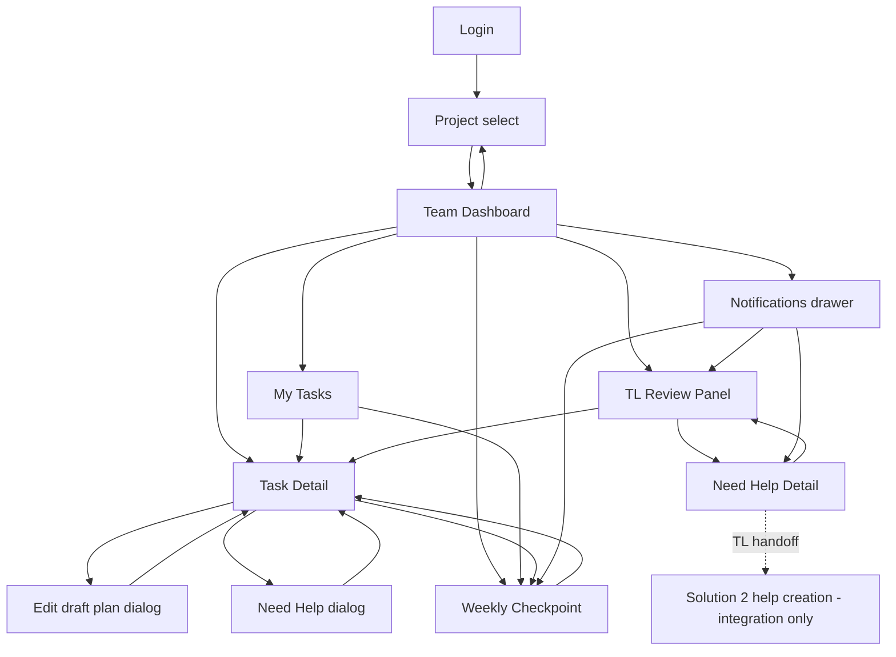

# HANARE MVP — SOLUTION 1: IMPLEMENTATION SPECIFICATION

> **This is the master spec for the coding agent.** Implement Solution 1 only. Do not implement Solution 2 business screens. Read the current repository and the actual `BE/database/hanare_mvp_v2_schema.sql` before coding. Preserve existing code and apply migrations only if needed; never drop data. Build functional web pages backed by the actual database, not static mock cards. Favor minimal reliable implementation over enterprise-grade complexity.

## 0. Mission, challenge, assumptions

**Challenge 1:** Students feel anxiety about group deadlines because progress updates depend on meetings or self-reporting, so missed work is sometimes discovered too late.

**Solution 1:** Give members confidence through explicit commitments and scheduled weekly checks; identify silence, missed targets or help requests early enough for the team leader to coordinate, without monitoring everyone continuously.

**Three minimum features**
- **F01 – Assign and confirm task commitments:** TL creates/assigns tasks. Members estimate and propose their own single timeline (`start_date`, `deadline`, expected deliverable). TL confirms; confirmed schedule is read-only to members.
- **F02 – Friday weekly checkpoint and shared dashboard:** All project members view member/task progress. Friday 15:30 (Vietnam time) remind those needing a report. Friday 22:00 close checkpoint and send TL one summary for outstanding issues. Members report task status for applicable tasks.
- **F03 – Risk alerts & Need Help:** Members can request help at any time; TL sees it immediately in app and decides what to do. TL reviews missing/unsuccessful reports, records response, and may hand off to Solution 2 (integration only, no automatic task redistribution).

### Boundaries
- One task has **one timeline**, no Plan A/B, no automatic rescheduling or task switching.
- No AI, Gantt, percent-complete estimates, work-hour tracking, push/email notifications, automated member punishment, or public performance ranking.
- Member status is a **weekly reporting state**, not an assessment of the person.
- MVP timezone is `Asia/Ho_Chi_Minh` (UTC+7). Equivalent local clock to `Asia/Bangkok`; implement consistently.
- Assume project contains one TL and multiple members; roles are per project, not global.
- Only Solution 1 changes belong in this work. Keep interfaces to Solution 2 stable through `taskId`, `projectId`, `supportRequestId`.

## 1. Existing database: authoritative schema

File: `BE/database/hanare_mvp_v2_schema.sql`, with exactly 10 tables, of which Solution 1 uses:

**Shared:**
- `users(id, name, email, password_hash)`
- `projects(id, name, deadline)`
- `project_members(project_id, user_id, role: LEAD|MEMBER)`
- `tasks(id, project_id, assignee_id, title, description, expected_output, start_date, deadline, status: TODO|IN_PROGRESS|DONE, planning_status: DRAFT|CONFIRMED, confirmed_by, confirmed_at)`

**Solution 1:**
- `task_reports(id, task_id, checkpoint_date [Friday], result: ACHIEVED|NOT_ACHIEVED, note, evidence_url, reported_at)`; unique `(task_id, checkpoint_date)`
- `support_requests(id, task_id, requested_by, reason, requested_help, status: OPEN|RESOLVED, leader_note, created_at, resolved_at)`
- `notifications(id, recipient_id, project_id, type: CHECKPOINT_REMINDER|CHECKPOINT_ALERT|NEED_HELP|HELP_UPDATE, title, message, checkpoint_date, read_at, created_at)`

**Solution 2 (do not implement):** `help_requests`, `contributions`, `compensations`. Do not change or duplicate these.

**Important:** `tasks` has no separate module table and no dependency table. TL may use title/description to identify a module. Do not invent dependency tracking UI/API. The DB does not contain a progress percentage, report approval state, checkpoint schedule table, or persistent risk review status. Use existing fields or carefully proposed optional additive migration only if strictly needed. Do not silently pretend these exist.

**Authentication:** Current SQL is custom-auth-shaped (`users.password_hash`), not Supabase Auth. Reuse the authentication method already present in the repo. If no auth exists, implement a simple safe sign-in/session flow with hashed passwords and session-backed currentUser; **never compare plaintext passwords, never return password_hash, never trust a userId sent by the client for authorization**. If repo already uses Supabase Auth, reconcile identity mapping explicitly rather than building a second login system.

## 2. Essential business rules: freeze before UI

### 2.1 Assignment and commitment (F01)
1. TL creates task: `title`, `description`, `expected_output`, `assignee_id` (must be member of project). `start_date` and `deadline` must be filled for DB insert; TL can place initial **provisional** dates, and task remains `DRAFT` pending member proposal. State visibly that these are provisional (schema requires a deadline).
2. Assigned member opens their DRAFT task, reviews scope, enters own realistic `start_date`, `deadline`, `expected_output`, optionally description, then selects **Submit plan for TL review**. Since DB has only `DRAFT` and `CONFIRMED`, save as `DRAFT` and communicate submission via lightweight UI state/notification or display all DRAFT tasks in TL review queue. Do not invent persisted `SUBMITTED` state unless a migration is explicitly justified.
3. TL opens DRAFT task, reviews proposed deliverable/dates, confirms. Save `planning_status='CONFIRMED'`, `confirmed_by=TL user id`, `confirmed_at=now()` in one operation.
4. Member cannot edit dates/output of a CONFIRMED task. TL can correct plans through a clearly labeled **Reopen draft** action: set planning_status=`DRAFT`, confirmed_by/confirmed_at to null, then re-confirm after member review. Any policy about edits must be enforced server-side; do not create an immutable-lock claim without enforcement.
5. A member may update **execution status** of own CONFIRMED task (`TODO` → `IN_PROGRESS` → `DONE`), and attach report at checkpoint; deadline is not silently changed by status updates. Marking `DONE` should not retroactively manufacture a weekly report; the actual task completion remains visible.
6. TL may adjust status if necessary and should record rationale in UI if doing so (no audit table in v2; do not claim audit history exists).

### 2.2 Weekly checkpoint scope (F02)
**Checkpoint = each Friday at 22:00 local, reminder = same Friday at 15:30 local.**

Define `weekStart = Monday 00:00`, `weekEnd = Sunday 23:59:59.999` in Vietnam time for the Friday in question. A **weekly due task** is a CONFIRMED task owned by the member and either:
- its deadline lies within **Monday through Sunday** of the selected week (whether DONE or unfinished); OR
- its deadline is before that Monday and it is still unfinished (overdue carried forward).

A **report-required task** is a weekly due task whose `status != DONE`. Only report-required tasks need `task_reports` for this Friday. A DONE task counts as completed in the weekly overview, without requiring a second report.

Display confirmed DONE tasks as **Completed** separately from "reports submitted". If a task is DONE with no report, display "Completed in task status / no weekly report" instead of silently creating a report. Completion time is not stored in `tasks` v2, so do NOT pretend to know when it was completed. For previous weeks, status history is not reconstructible precisely.

A task due Sunday appears in Friday checkpoint, but **NOT_ACHIEVED on Friday means target not completed at checkpoint, not necessarily deadline overdue**. Show separate `deadlineOverdue = deadline < now && status != DONE`. Distinguish checkpoint outcome from deadline breach.

Task with deadline next week or later is **not mandatory to report this Friday**. It can optionally be updated via ordinary task status or Need Help at any time. This is an explicit MVP limitation for long tasks; no interim milestone table exists.

A task reported `NOT_ACHIEVED` last Friday and still not DONE remains eligible next Friday. Each task can have at most one row per Friday in `task_reports`. The member may correct their report **before 22:00 on that Friday** (upsert); after 22:00, reports become read-only in UI and via backend. Late submission after 22:00 is deliberately excluded for MVP: TL handles missing report directly and member can report next week; show missing as missing, do not auto-mark delayed.

Do **not** require the member to upload files: `note` is short text, `evidence_url` optional. For `NOT_ACHIEVED`, a reason/note is required by application validation. For `ACHIEVED`, encourage a concise result note. If `ACHIEVED` represents task finished, member explicitly marks task status `DONE`; do not automatically infer DONE for incomplete task without a user confirmation.

### 2.3 Weekly dashboard color for each member
Use only tasks in the relevant weekly scope, and compute **after Friday 22:00** for final weekly status; prior to 22:00 show **Live / Awaiting checkpoint** plus provisional report counts, never call someone RED before the deadline.
- **GRAY**: zero weekly due tasks.
- **GREEN**: every weekly due task is either DONE or has an `ACHIEVED` Friday report, with no missing/NOT_ACHIEVED tasks.
- **RED**: at least one report-required task and **zero reports** for those tasks by Friday 22:00, with no DONE weekly tasks (i.e. no evidence of completed or reported work in the selected cohort).
- **YELLOW**: at least one weekly due task has been completed or reported, but at least one report-required task is `NOT_ACHIEVED` or missing.

Explicitly show `DONE` separately from `ACHIEVED` (self-reported checkpoint result). If a DONE weekly task is present but another task lacks a report, use YELLOW, not RED; RED is reserved for a completely unreported/uncompleted eligible weekly cohort.

Task reports `ACHIEVED` are self-reported; do not label them TL-verified or quality-approved. Show counts `due`, `reported`, `achieved`, `not achieved`, `missing` and a clear status explanation. Due tasks that became DONE during the week need special care: without `completed_at`, the dashboard cannot prove they were finished before deadline. Display task status truthfully and avoid calling it "on-time completion" solely based on DONE. The dashboard is a **reporting overview**, not performance scoring.

**Implementation alternative to resolve completed task accounting:** At Friday 15:30 scheduler evaluate eligible scope; at 22:00 store a snapshot (would require new table). Since we chose no extra table, live historical reconstruction of past weeks is approximate when task status/deadline changes. For MVP, emphasize **current week's view**; do not promise exact historical dashboard or long-term scorecards. TL can view task_reports by checkpoint date separately.

### 2.4 Notifications and TL action (F03)
- Friday 15:30: for each member with at least one report-required task missing a report, create **one** `CHECKPOINT_REMINDER` notification (not one per task).
- Friday 22:00: for each project with any missing or NOT_ACHIEVED reports, create **one summary** `CHECKPOINT_ALERT` notification addressed to its TL. No issue -> no TL alert.
- Need Help: member may click from **any assigned task at any time**, enter a `reason` and optionally `requested_help`; create `support_requests` OPEN and immediately create `NEED_HELP` notification(s) for project TL.
- TL opens alert, examines related tasks and person, contacts them outside app if needed; TL may add `leader_note` and mark `support_requests` RESOLVED, or open Solution 2 handoff. **No auto-assignment, no automatic creation of a volunteer job, no automatic accusation of non-cooperation.**
- Notifications are **in-app**. Web users will see them when fetching or refreshing. If true real-time is not built, don't claim instantaneous push delivery.
- DB v2 has no unique `(recipient_id, type, checkpoint_date, project_id)` index and no task link in notifications; scheduler MUST be idempotent via transactional checks or a minimal additive index/migration (coordinate with shared DB owner), and notification click goes to project/team review rather than fabricated task deep-link.
- For classroom demo without deployed cron, also support a protected test-only action or a script to run reminder/checkpoint jobs for an explicit Friday. Do not expose unauthenticated production endpoints.

### 2.5 Relationship to Solution 2
On TL decision **"Create volunteer help request"**, link to `/projects/:projectId/help/new?taskId=:taskId` if Team B's route exists. If it does not exist yet, show `Solution 2 is not implemented` / non-destructive disabled action, not a fake success. Pre-fill task ID when Team B later integrates. Keep `support_requests` distinct from `help_requests`: the first asks TL for attention, the second invites volunteers after TL decision.

## 3. Screen navigation map (pages vs dialogs)



**Pages / routes:**
- `/login` existing auth (reuse)
- `/projects` project selection (simple if many; can skip selection in seeded single-project demo)
- `/projects/[projectId]` Team Dashboard, all members can read
- `/projects/[projectId]/tasks` My Tasks; TL can switch to team tasks
- `/projects/[projectId]/tasks/[taskId]` Task Detail, including plan proposal, confirmation, status, Need Help trigger
- `/projects/[projectId]/checkpoint` Weekly Checkpoint form for member
- `/projects/[projectId]/review` TL-only Review Panel (task approvals, missing weekly reports, failed checkpoints, Need Help)

**Dialogs/drawers, not separate routes:** New Task (TL), Edit Draft Task (member), Confirm Task (TL), Need Help, Notification drawer, Support Request Detail (can be drawer on TL review).

**Persistent navigation:** Header with project name, Friday checkpoint indicator, notifications bell, user name; sidebar with `Dashboard`, `My Tasks`, `Weekly Checkpoint`, and TL-only `Team Review`. No standalone Recovery Plan or Plan A/B pages.

## 4. Required screens (detailed)

### S01 — Team Dashboard — `/projects/[projectId]`
**All members can view. Purpose:** see weekly commitments/results without having to chase everyone in chat. TL gets additional shortcut.

**Top section**: project name; local current date; next Friday 22:00; remaining time optional (no countdown pressure required). Cards: `Tasks due this checkpoint`, `Reports received`, `Needs TL attention` (TL only), `My tasks due`.

**Member Overview table** (all project members, one row each): member name, due-task count, number reported, number ACHIEVED, number NOT_ACHIEVED, number missing; weekly color (GREEN/YELLOW/RED/GRAY) with text label, not color-only. Clicking a member expands their due task names/results; all team members may view progress, but only task owners may edit reports. Do not expose private support request reason to every member by default.

**My Work widget:** tasks owned by current user, ordered overdue then deadline ascending; show title, deadline, execution status, planning status. Buttons `View Task`, `Report Checkpoint` if due.

**TL attention widget** (TL-only): count of overdue/no report, NOT_ACHIEVED, open Need Help. Button `Review issues` -> S05.

**States:** loading skeleton, empty project, no members, all-gray no due tasks, pre-22:00 provisional states, after-22:00 final states, network error with retry.

### S02 — My Tasks — `/projects/[projectId]/tasks`
**Member:** assigned task list with filters `All`, `Draft`, `Confirmed`, `Due this week`, `Overdue`, `Done`; columns/cards title, description excerpt, expected output, start_date, deadline, status, planning_status; `Open Task` click -> S03. Member sees `Edit proposal` only for own DRAFT.

**TL:** switch `My Tasks` / `Team Tasks`. Team Tasks shows assignee, approval state, deadlines; `Create Task` dialog with assignee, title, description, expected output and provisional dates (required deadline); `Draft plans to review` shortcut -> S05. No automatic assignment/estimation.

**On create:** validate member in project, nonempty title, valid start_date <= deadline, return new task ID; redirect to S03. For child modules, use descriptive title/description, not a separate module model.

### S03 — Task Detail & commitment — `/projects/[projectId]/tasks/[taskId]`
**Top:** task title, assigned member, execution status, planning status, start_date, deadline, expected_output, description. Clear notice when DRAFT: `Not confirmed. Dates may change.` When CONFIRMED: `Confirmed by TL at ...`.

**Member DRAFT actions:** edit start_date/deadline/expected_output, save. `Send for TL confirmation` communicates that TL should review; implementation uses existing DRAFT queue (no SUBMITTED enum). Prevent editing another member's task or confirmed schedule.

**TL actions:** confirm DRAFT (atomic fields confirmed), optionally reopen confirmed plan to DRAFT with confirmation prompt; TL can edit task scope in DRAFT, not silently alter confirmed timeline.

**Member CONFIRMED actions:** set execution `TODO`, `IN_PROGRESS`, `DONE` (with confirmation on DONE), `Open checkpoint report` -> S04 when eligible, `Need Help` dialog any time. Task status changes do not change planning_status or deadline.

**Checkpoint history list:** Friday date, result, note, evidence link, reported time; no edit past checkpoint. **Need Help indicator:** member sees own support request status and TL note; show `Need Help` button even if task is DRAFT if the user encounters a problem (support is not limited to checkpoint).

### S04 — Weekly Checkpoint — `/projects/[projectId]/checkpoint`
**Member:** heading `Weekly checkpoint — Friday DD/MM/YYYY, deadline 22:00 (Vietnam time)`. Show local time, status `OPEN`, `CLOSED`, or `NOT YET DUE`. Include only actionable due tasks defined in §2.2 (confirmed, not done, due by week Sunday incl overdue). For each: task title, actual deadline, task status, previous checkpoint result if any, report selector `ACHIEVED` / `NOT_ACHIEVED`, note, evidence_url optional. When NOT_ACHIEVED require reason. Button `Save report`; allow corrections before cutoff (upsert). Status `Submitted` after save. Preserve input drafts while navigating within page; prevent double submit.

**If no tasks due:** `No tasks require a checkpoint this week` and link My Tasks.

**If task due Sunday, report Friday:** explicit note `Checkpoint is on Friday; the task deadline is Sunday. Not achieved now does NOT automatically mean overdue.`

**After 22:00:** read-only view. Missing reports shown `Not submitted` with TL review notice. No hidden late submit; member may use Need Help or direct contact.

**TL:** can view read-only reports for team in S05. Do not use S04 as an all-member edit screen.

### S05 — TL Review — `/projects/[projectId]/review`
**Access:** only LEAD, nonlead gets 403 / safe redirect.

**Tabs** within this single page:
1. `Draft plans`: list all DRAFT tasks, assignee, proposed dates/output; button Review -> S03, confirm there.
2. `Weekly checkpoint`: choose Friday (default current Friday), table one row per member with same status as Dashboard; expand each member to see due tasks and report outcome, missing results, whether actually overdue. Filter `Only issues`. Display missing vs NOT_ACHIEVED separately. Allow TL to mark `Reviewed` in UI only if a persistent review tracking field has been explicitly added; otherwise do **not** show a fake persistent Reviewed status, just let TL open task and contact member.
3. `Need Help`: list OPEN support_requests with member, task, reason, created_at; detail drawer shows full text, optional requested_help and TL note. `Resolve` saves leader_note, status RESOLVED, resolved_at. If real Team B route exists, link to Solution 2 via taskId; not auto-create volunteer request.

**TL reminder:** at Friday 22:00 receive one CHECKPOINT_ALERT if issues exist, click -> this page with query param `?tab=weekly&date=YYYY-MM-DD`.

### S06 — Notification Drawer — available globally
Bell in header. Unread count. Show latest 20 notifications, type icon, title, time, read/unread, `Mark read`, click routes:
- `CHECKPOINT_REMINDER` -> S04
- `CHECKPOINT_ALERT` -> S05 weekly (TL only)
- `NEED_HELP` -> S05 Need Help (TL only)
- `HELP_UPDATE` -> S03 or task-related view if resolvable, else S02

Use notifications table. No email or browser push. If notifications arrive while page is open, refreshing or periodic polling can reveal them; do not promise live websocket updates.

## 5. One concrete walk-through

- Project has TL and Members A, B, C.
- TL assigns A a `Frontend screen` task (`DRAFT`) with provisional Friday deadline, and B an `API` task with a 2-week deadline.
- A edits own start_date, deadline, expected_output. TL confirms. B also proposes and TL confirms.
- On a Friday 15:30: only tasks due by that week's Sunday (or overdue) are included in the weekly cohort; only unfinished tasks require reports. `API` due two weeks later does not need a Friday report this week.
- A receives one reminder if a due task has no report.
- A files `ACHIEVED` + link; if truly completed, A marks task DONE.
- C has 2 actionable tasks and reports one `ACHIEVED`, one `NOT_ACHIEVED` with reason -> YELLOW after 22:00.
- B has 1 actionable task, submits none -> RED after 22:00, TL must check; never label B absent or lazy.
- TL gets a single summary at 22:00 with C/YELLOW, B/RED; click review to inspect and contact.
- During any weekday, B can click `Need Help` on API; TL gets NEED_HELP notification, opens detail and may decide to create a separate Solution 2 help request later. Nothing is automatically reassigned.

## 6. Permissions matrix

| Action | LEAD | MEMBER |
|---|---|---|
| View project-wide Dashboard & member task progress | yes | yes |
| Create/assign task | yes | no |
| Edit DRAFT timeline | yes | own tasks |
| Confirm plan | yes | no |
| Edit CONFIRMED deadline without reopening | no | no |
| Change execution status | yes | own tasks |
| Submit checkpoint report | own assigned tasks if applicable | own assigned tasks |
| View full team checkpoint reports | yes | summary; see task progress only |
| Submit Need Help | own task | own task |
| View private Need Help reason | yes | own request |
| Resolve Need Help | yes | no |
| Access TL review | yes | no |

Always verify authenticated membership and task ownership on server, including on every read/write ID.

## 7. API/service contract (recommended, adjust to existing stack)

`GET /api/projects/:projectId/dashboard?checkpointDate=YYYY-MM-DD` -> member weekly summaries, current user tasks, TL attention counts; backend computes status from database (no status color stored).

`GET /api/projects/:projectId/tasks?scope=mine|team` -> tasks list (team permitted if LEAD; members can view team progress via Dashboard but cannot edit).

`POST /api/projects/:projectId/tasks` -> TL creates DRAFT task, provisional deadline required.

`GET /api/tasks/:taskId` -> detail with rights and checkpoint reports.

`PATCH /api/tasks/:taskId/plan` -> owner or TL edits DRAFT dates/output only.

`POST /api/tasks/:taskId/confirm` -> TL confirms DRAFT task.

`POST /api/tasks/:taskId/reopen` -> TL makes CONFIRMED task DRAFT; clear confirmed_*.

`PATCH /api/tasks/:taskId/status` -> owner/TL updates TODO/IN_PROGRESS/DONE.

`GET /api/projects/:projectId/checkpoint?date=YYYY-MM-DD` -> owner's eligible tasks + reports; date must be Friday.

`PUT /api/tasks/:taskId/reports/:checkpointDate` -> upsert ACHIEVED/NOT_ACHIEVED, before that Friday 22:00 local, task owner only, eligible task only.

`POST /api/tasks/:taskId/support-requests` -> member on own task; reason required; create support_requests + TL notification in transaction.

`GET /api/projects/:projectId/review?date=YYYY-MM-DD` -> TL only; drafts, missing/unachieved, support_requests.

`PATCH /api/support-requests/:id/resolve` -> TL sets resolved status, note, resolved_at.

`GET /api/notifications` & `PATCH /api/notifications/:id/read` -> current recipient only.

`POST /api/internal/checkpoint/remind` + `POST /api/internal/checkpoint/finalize` -> scheduler-only secured endpoints (not public regular user actions); jobs must be repeat-safe. Provide admin script for demo.

**Return format:** `{success: true, data: ...}` or `{success:false,error:{code,message}}`. Use 400 validation, 401 auth, 403 unauthorized, 404 missing/unavailable, 409 conflict for locked/reported state.

## 8. Friday business logic pseudocode

```text
fridayFor(localDate): compute Friday date in Vietnam timezone
weekEnd(friday): Sunday 23:59:59.999 Vietnam time

weeklyDueTasks(project, member, friday):
  all CONFIRMED tasks for this project/member where
    (deadline within Monday-Sunday of selected week) OR
    (deadline < weekStart AND status != DONE)

requiredReports = weeklyDueTasks.filter(status != DONE)

computeWeeklyStatus(member, friday, afterCutoff):
  due = weeklyDueTasks(...)
  if due.empty -> GRAY
  if !afterCutoff -> PENDING / provisional, not final RED
  reports = task_reports where checkpoint_date = friday and task_id in due
  success(task) = task.status == DONE OR reports[task].result == ACHIEVED
  if due.every(success) -> GREEN
  if due.every(task => task.status != DONE) AND reports.count == 0 -> RED
  return YELLOW

reminderJob(friday, localTime==15:30):
  for each member with due tasks missing report:
    ensure at most one CHECKPOINT_REMINDER notification per member+project+friday

finalizeJob(friday, localTime>=22:00):
  for each project:
    if any report-required task missing report or report NOT_ACHIEVED:
      ensure one CHECKPOINT_ALERT per TL+project+friday
```

**Known tradeoff:** With no historical task snapshot / `completed_at`, dashboard reconstructions from *current* task state will not perfectly reproduce previous Fridays if tasks are later completed or deadlines are amended. For the MVP, show the **current week's dashboard** and explicit task_reports history. If the instructor requires accurate historical weekly green/yellow/red dashboards, request approval for one additional `checkpoint_snapshots` table or `completed_at` plus snapshot logic; don't silently fabricate history.

**Potential edge case:** If a user submits `ACHIEVED` and marks the task DONE before the Friday deadline, it drops out of the actionable pending list. This is acceptable for **current outstanding reports**, but a dashboard's original weekly denominator should then be presented carefully. Prefer separate `completed tasks` counts and no fake precise historical totals.

## 9. UI design guidance
- Desktop: shared sidebar 220–240px; page header; readable cards/table. Mobile: drawer sidebar, stack member rows to cards.
- Neutral/clean UI; green/yellow/red statuses paired with descriptive text, not colors alone.
- Use consistent action names: `Create Task`, `Save Draft`, `Confirm Plan`, `Submit Checkpoint`, `Need Help`, `Resolve`.
- Every destructive/reversible change asks confirmation; ensure forms validate, show spinner, toast, error retry, empty/loading states.
- Single timeline per task; never render fake Plan B, second deadline, predicted completion, or cumulative progress %.
- Project-wide dashboard visibility is explicit user choice here; don't expose private Need Help text to all members.

## 10. Tests / acceptance criteria

**F01:**
1. TL assigns DRAFT task to a valid project member; another project's user rejected.
2. Member edits own DRAFT dates/output; cannot edit someone else's.
3. TL confirms; confirmed_at/confirmed_by set, member edits are blocked in UI and API.
4. TL reopens; draft can be adjusted and reconfirmed.
5. Task has exactly one effective timeline; no Plan A/B routes.

**F02:**
6. 15:30 Friday reminder only for members with actionable due tasks lacking reports, once per project-member-Friday.
7. Task due next week not required in current Friday report.
8. Task overdue from previous week and unfinished still required.
9. Task due Sunday can be NOT_ACHIEVED Friday without being labelled overdue until actual deadline passes.
10. Two unfinished tasks due: 2 ACHIEVED -> GREEN; 1 ACHIEVED + 1 NOT_ACHIEVED -> YELLOW; 0 reports -> RED after cutoff. Two DONE tasks due this week -> GREEN; one DONE plus one missing unfinished task -> YELLOW; zero weekly due tasks -> GRAY.
11. Reports editable before 22:00, server blocks corrections after.
12. Dashboard accessible to all project members; no data from other projects.

**F03:**
13. Need Help on owned task creates support_request + TL notification immediately, independent of checkpoint.
14. TL can read reason, add leader_note and resolve; member cannot resolve.
15. 22:00 summary once per project TL, only if issues; repeated job does not duplicate it.
16. Alert click opens TL review. Other members cannot access it.
17. Handoff to Team B is only a link with real task ID (when available); no automatic reassignment.

**Engineering:**
18. Run database migration/seed from empty environment; verify login, roles, server authorization.
19. No mock data in actual production views; seed permitted for demo.
20. Tests for timezone Friday/Sunday boundaries, duplicate notifications, concurrent report upserts.
21. Responsive 375px and desktop; loading/empty/error handling.

## 11. Suggested implementation phases and required output

1. **Inspect and document:** repository structure, auth strategy, actual DB tables, runtime scripts, risks. Make route map and API contract. Do not change DB before checking.
2. **Shared UI and task foundation:** app shell; task list/detail, TL create, member plan draft, TL confirm, permission checks.
3. **Weekly checkpoint:** eligible task query, Friday date helpers, report form, upsert, member table; calculate colors precisely with edge cases.
4. **Notifications & TL Review:** reminder/finalize cron scripts, notifications drawer, TL review tabs, Need Help workflow.
5. **Test and demo:** unit, integration and E2E, seed 6 users + TL + tasks due/overdue/no tasks, mobile, execute complete demo.

For each phase supply: files changed, routes implemented, DB migrations (if any), passing test commands, remaining limitations. Do not claim test passes without running them. Don't write fake button interactions or store state only in browser memory.

## 12. Open questions / decisions fixed for this MVP

- Checkpoint scope: confirmed tasks not DONE with deadline by current Sunday, plus overdue unfinished tasks. This is a **design decision** adopted to resolve Friday reporting of Sunday deadlines; review with TL before implementing a different definition.
- Friday 15:30 and 22:00 local fixed. In-app notifications, no external messaging.
- Long tasks (>1 week) have no forced interim check; owners may use Need Help anytime. This is a known product limitation, not a bug.
- Only TL can assign tasks and finalize plan. Members propose own dates for DRAFT tasks.
- Weekly colors describe report state, never call a person irresponsible or absent.
- One current timeline, no Plan A/B or Gantt.
- If current code/schema differs from this spec, prefer preserving existing data and ask for approval on a destructive migration; for safe additions, describe migration explicitly.

**End of specification.**
