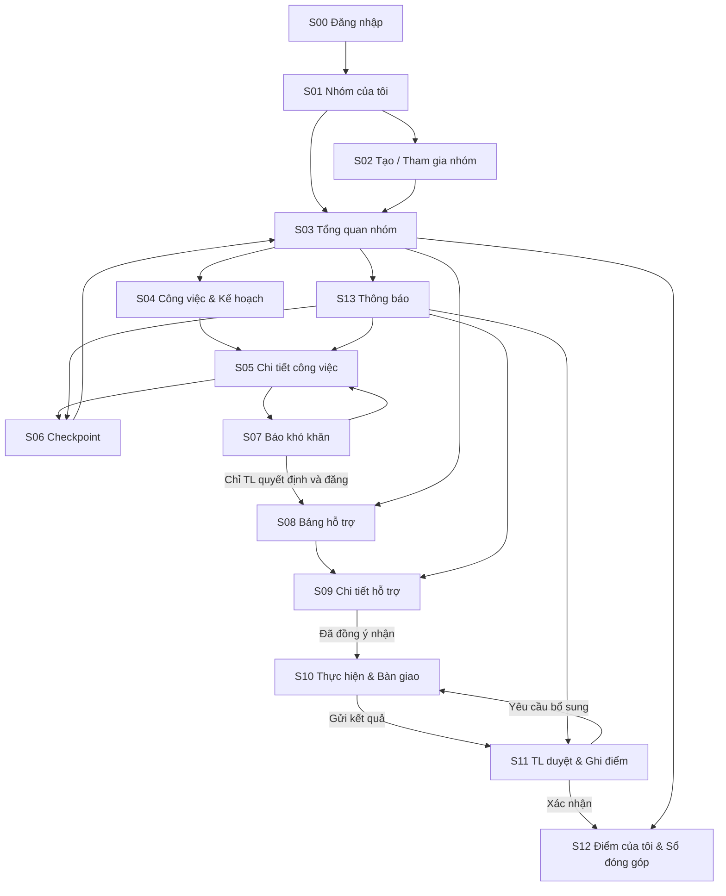
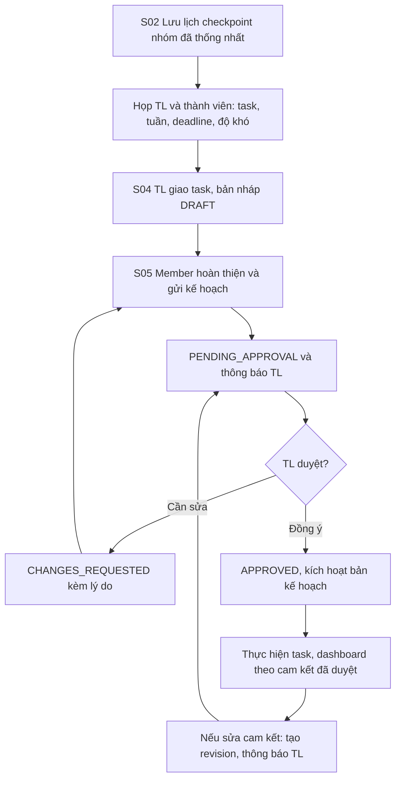
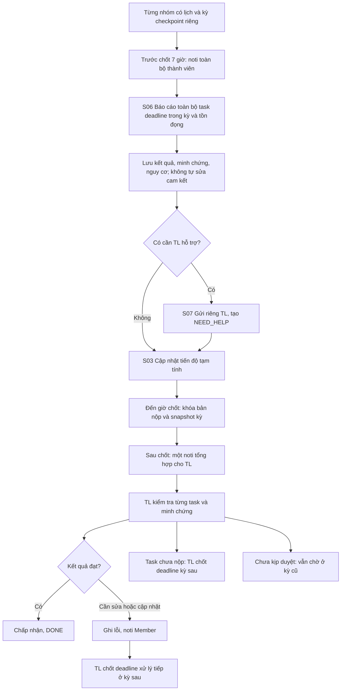
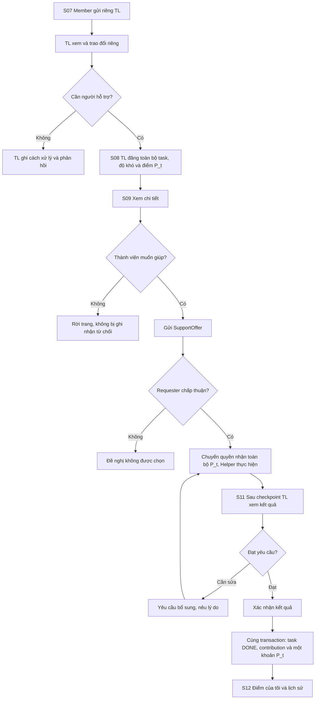
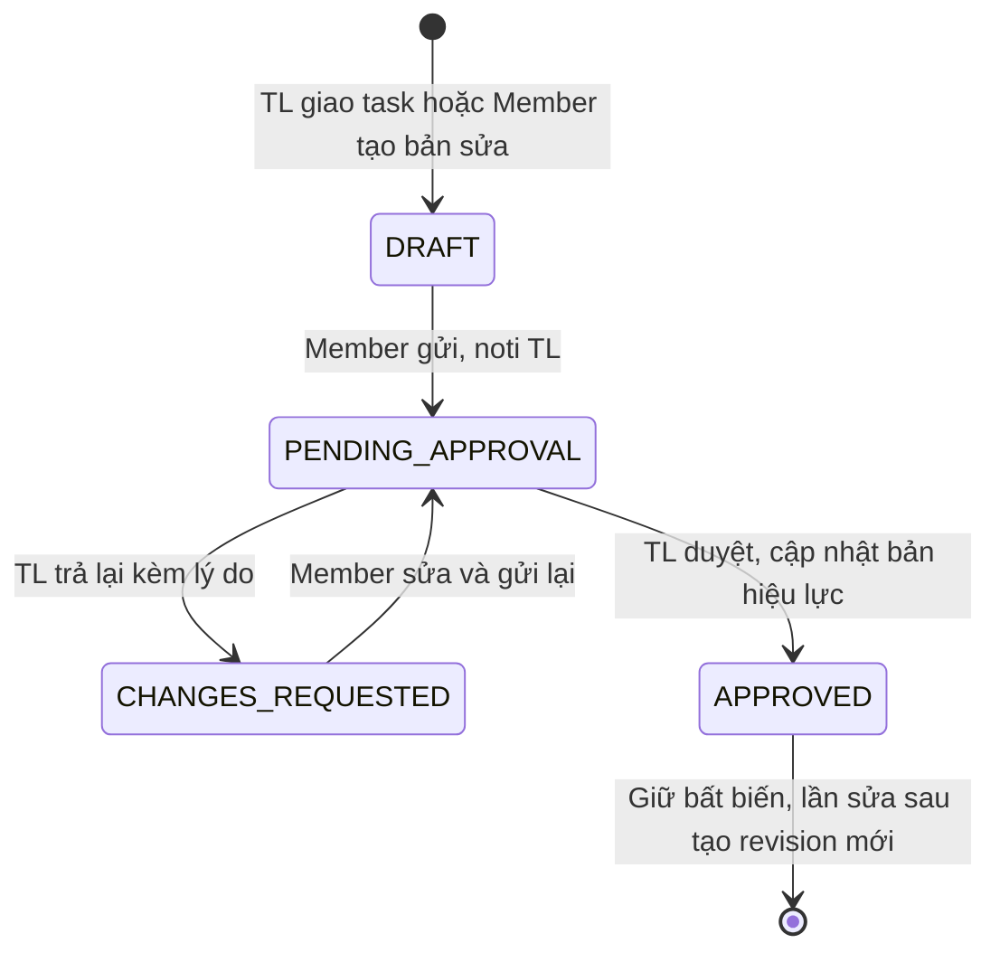
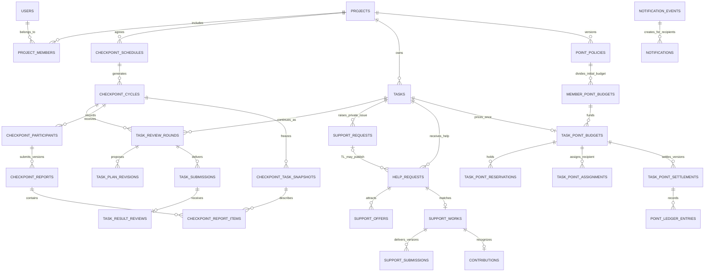

# HANARE — Đặc tả UX/UI & Sơ đồ chuyển màn hình

> **Phiên bản:** 1.2 — bổ sung điểm Solution 2 và quyết định đã xác nhận ngày 15/11/2026; thiết kế DB ở mục 12  
> **Đối tượng sử dụng:** Học sinh, sinh viên làm bài tập nhóm  
> **Nền tảng:** Web responsive, ưu tiên mobile-first  
> **Phạm vi:** MVP gồm 2 Kadai, 2 Solution, 6 nhóm tính năng cốt lõi; 14 màn hình/luồng từ S00–S13  
> **Tài liệu nền:** [MVP資料_火2_ハナレ](https://docs.google.com/spreadsheets/d/1QMkFkHUs6YruM3Ie5FJNnjKsvdtLUuIv8D9mGmFnQXs/edit) — tab `ソリューションインタビュー準備`  
> **Công nghệ mục tiêu:** Backend **Java + Spring Boot**, frontend **React**, giao tiếp qua REST API; cơ sở dữ liệu quan hệ **PostgreSQL**.  
> **Lưu ý:** Yêu cầu đã xác nhận được tổng hợp tại mục 0.4–0.9 và mục 13. Quỹ 100% toàn dự án, quyền vượt phần ban đầu và chuyển toàn bộ điểm task đã được chủ sản phẩm xác nhận; trọng số 1/2/3 và chi tiết DB là phương án thiết kế đề xuất. Tài liệu mô tả đích triển khai, không đồng nghĩa code hoặc DB hiện tại đã đáp ứng.

---

## 0. Tóm tắt ý tưởng và định hướng thiết kế

### 0.0. Định hướng công nghệ ngay từ đầu

- **BE:** Java + Spring Boot; API xử lý xác thực, phân quyền theo nhóm, duyệt kế hoạch, checkpoint, hỗ trợ và thông báo. Mọi phép tính deadline, trạng thái, điểm và chuyển quyền nhận điểm phải do server quyết định.
- **FE:** React, web responsive/mobile-first; hiển thị các màn hình S00–S13 và gọi REST API của BE. Không lưu trạng thái nghiệp vụ chính thức chỉ trong trình duyệt.
- **DB đề xuất:** PostgreSQL, tiếp nối DB đang có trong repo; quản lý thay đổi bằng Flyway, giữ dữ liệu cũ. Thiết kế chi tiết và lộ trình chuyển đổi tại mục 12.
- **Lịch chạy:** BE kiểm tra các kỳ checkpoint đến hạn theo cấu hình từng nhóm; không cố định một cron thứ Sáu cho mọi nhóm. Cần lưu sự kiện/thông báo bền vững và chống tạo trùng khi chạy lại.
- **Hiện trạng đối chiếu:** `BE/pom.xml` đã dùng Java/Spring Boot/PostgreSQL. `FE/package.json`, `FE/templates` và `FE/static` hiện là FE dùng template/JavaScript, chưa phải ứng dụng React. Chuyển FE sang React là công việc triển khai tiếp theo; lần cập nhật tài liệu này chưa sửa mã nguồn.

### 0.1. Vấn đề, mục tiêu và tính năng

**Kadai ① — Giảm lo lắng khi không biết rõ tiến độ của thành viên khác.**  
Solution: Tạo sự tin cậy vào các cam kết; kiểm tra định kỳ; phát hiện nguy cơ và chủ động ứng phó, thay vì liên tục phải hỏi người khác.

1. Thiết lập và xác nhận kế hoạch công việc.
2. Checkpoint định kỳ và nhắc nhở cập nhật.
3. Phát hiện nguy cơ, khai báo khó khăn và yêu cầu hỗ trợ.

**Kadai ② — Giảm cảm giác bất công khi phải gánh thêm phần việc của người khác.**  
Solution: Hỗ trợ dựa trên lựa chọn tự nguyện; ghi nhận nỗ lực phát sinh và chỉ điều chỉnh phân công trên cơ sở đồng thuận.

4. Đăng phần việc cần hỗ trợ (nội dung, thời hạn, công sức dự kiến).
5. Thành viên tự nguyện đề nghị nhận việc; không tự động ép nhận.
6. TL xác nhận kết quả, ghi nhận đóng góp và điểm từ quỹ task; thành viên xem điểm cá nhân và biến động chuyển/nhận task.

**Phương án mới cho Solution 2:** **Ghi nhận đóng góp và điểm** sau TL chấp nhận kết quả. Quỹ **100% cho toàn dự án**, chia phần ban đầu `100/N` mỗi người; thành viên được vượt phần ban đầu bằng điểm chuyển từ task người khác. Một yêu cầu có điểm là nhận làm thay **toàn bộ task**, chuyển **toàn bộ P_t** cho Helper nếu được duyệt; không tạo thêm quỹ, nợ công hay nghĩa vụ bù đắp.

### 0.2. Nguyên tắc UX không được phá vỡ

- **Hành động tối thiểu:** một checkpoint bình thường có thể cập nhật bằng 2–3 thao tác.
- **Trung lập, không đổ lỗi:** “Chưa có cập nhật” khác “Chậm tiến độ”; “Có nguy cơ” không phải “Không có trách nhiệm”.
- **Cam kết hai chiều:** người nhận task phải chấp thuận phạm vi và mốc thời gian.
- **Hỗ trợ tự nguyện:** người hỗ trợ có quyền bỏ qua, không giải thích lý do, không bị chấm điểm tiêu cực.
- **Xác nhận minh bạch:** công sức được ghi nhận khi có kết quả bàn giao và bên nhận xác nhận, không chỉ dựa trên lời khai một phía.
- **Không công khai xếp hạng con người:** chỉ hiển thị thông tin task và đóng góp đã được ghi nhận.
- **Hỗ trợ điện thoại:** cỡ mục tiêu nhấn tối thiểu 44×44 CSS px; biểu mẫu ngắn; không phụ thuộc thao tác hover.
- **Không quá tải thông báo:** chỉ thông báo khi cần hành động hoặc sự thay đổi có ảnh hưởng thực sự.

### 0.3. Vai trò và giới hạn quyền

| Vai trò | Quyền chính | Giới hạn quan trọng |
|---|---|---|
| **Trưởng nhóm (TL/Leader)** | Tạo nhóm; mời người; họp chốt task/tuần/độ khó; duyệt kế hoạch và thay đổi; lưu lịch checkpoint nhóm đã thống nhất; xem dashboard; xử lý đề nghị hỗ trợ riêng; đăng yêu cầu hỗ trợ công khai | Không ép thành viên nhận hỗ trợ; không ghi đè cam kết hay công sức đã xác nhận mà không có lịch sử |
| **Thành viên (Member)** | Lập/gửi kế hoạch task của mình; đề xuất sửa kế hoạch; cập nhật tiến độ; báo cáo tuần; gửi đề nghị hỗ trợ riêng cho TL; xem bảng hỗ trợ và tự nguyện đề nghị nhận việc | Không tự duyệt kế hoạch; không tự đăng yêu cầu hỗ trợ công khai; không sửa cam kết người khác; không tự xác nhận đóng góp của mình |
| **Người đăng yêu cầu hỗ trợ (Requester)** | Chọn người hỗ trợ; duyệt hoặc yêu cầu bổ sung kết quả | Không tự sửa nội dung công sức người khác khai báo mà không cho họ biết |
| **Người hỗ trợ (Helper)** | Tự nguyện đề nghị; xác nhận phạm vi; thực hiện và bàn giao; xem ghi nhận | Không tự duyệt hoàn tất công việc do mình bàn giao |

> Requester/Helper là **vai trò theo từng yêu cầu**, không phải loại tài khoản. TL đăng yêu cầu có điểm, chọn Helper và duyệt kết quả/điểm. Người đang cần hỗ trợ là `beneficiary`, lưu riêng với người đăng/người làm thay. Chỉ task thường của chính TL có ngoại lệ người duyệt độc lập đã được nhóm chỉ định trước, có audit; không ai được tự duyệt điểm mình nhận.

### 0.4. Solution 1 — Quy trình kế hoạch tuần đã được yêu cầu

1. Thành viên họp cùng TL để thống nhất task cho từng người, tuần thực hiện, đầu ra, mốc bắt đầu/deadline và độ khó **Dễ / Trung bình / Khó** (`EASY / MEDIUM / HARD`). Độ khó là đầu vào công thức điểm đề xuất 1/2/3 tại mục 0.9/12.8; điểm được khóa theo phương án phân công trước khi công khai task có thể nhận làm thay.
2. TL tạo/giao task theo cuộc họp. Thành viên lập kế hoạch của mình: lưu `DRAFT`, gửi TL thì chuyển `PENDING_APPROVAL` và tạo thông báo cho TL.
3. TL duyệt → phiên bản kế hoạch `APPROVED`, cam kết chính thức có hiệu lực. Nếu chưa phù hợp, TL trả lại `CHANGES_REQUESTED` kèm lý do để thành viên sửa và gửi lại.
4. Sau khi đã duyệt, thay đổi tuần, phạm vi, đầu ra, người phụ trách, mốc thời gian hoặc độ khó phải tạo **phiên bản đề xuất mới** và thông báo TL duyệt lại. Bản đã duyệt vẫn có hiệu lực trong lúc chờ; bản nháp mới chưa làm thay đổi deadline/dashboard.
5. Cập nhật tiến độ, gửi minh chứng, báo khó khăn và gửi checkpoint không mặc nhiên là sửa kế hoạch. Các thao tác này giữ deadline đã duyệt; thay đổi cam kết đi qua bước 4.
6. Cuối kỳ, mỗi người báo cáo **toàn bộ task có deadline từ sau checkpoint trước đến checkpoint hiện tại**, kể cả task đã nộp; có thể xác nhận hàng loạt với dữ liệu điền sẵn. Sau giờ chốt, TL kiểm tra từng task và minh chứng để chấp nhận hoặc yêu cầu sửa/cập nhật theo mục 0.8.

### 0.5. Checkpoint theo thỏa thuận từng nhóm

- Nhóm thống nhất lịch lặp hằng tuần: ngày trong tuần, giờ chốt, múi giờ và khung mở báo cáo. TL lưu cấu hình thay mặt nhóm, ghi thời điểm/người lưu; không yêu cầu chức năng bỏ phiếu trong MVP.
- **Ví dụ của yêu cầu:** chốt **22:00 thứ Sáu** → thông báo cho **toàn bộ thành viên đang hoạt động, gồm TL**, lúc **15:00 cùng ngày** (`22:00 − 7 giờ`). Đây là ví dụ cấu hình của một nhóm, không phải lịch bắt buộc cho mọi nhóm.
- Sau giờ chốt, hệ thống tạo **một thông báo tổng hợp cho TL mỗi kỳ** để TL vào kiểm tra, kể cả khi tất cả đã báo cáo. Tóm tắt số đã/chưa báo cáo, task đã xong, task trễ, nguy cơ và đề nghị hỗ trợ chưa xử lý.
- Việc nhắc trước 7 giờ **không đồng nghĩa** form chỉ được mở trong 7 giờ đó. `opens_at` và `closes_at` của từng kỳ phải lưu rõ. Đề xuất mặc định cho gửi báo cáo trong cả kỳ; nhóm có thể thống nhất khung hẹp hơn, nhưng khung mở không làm đổi phạm vi deadline của kỳ.
- Lịch mới chỉ áp dụng cho các kỳ tương lai chưa mở. Kỳ đã mở/đóng giữ lịch, múi giờ và phạm vi đã lưu; không tự dời hạn hoặc xóa lịch sử. Đổi lịch phải thông báo cả nhóm.
- Khi đóng kỳ, khóa báo cáo/minh chứng của lần nộp để TL kiểm tra. Kết quả duyệt của TL được ghi **sau chốt**, liên kết đúng phiên bản minh chứng; không ghi đè ảnh chụp dữ liệu tại giờ chốt. Thiếu kết quả hoặc cần sửa thì TL chốt deadline xử lý tiếp ở kỳ sau, không cho sửa ngược báo cáo đúng hạn.
- **Đã chốt C01:** kỳ báo cáo là `(checkpoint trước, checkpoint hiện tại]`. Ví dụ từ **sau 22:00 thứ Sáu 13/11/2026 đến hết 22:00 thứ Sáu 20/11/2026**. Deadline đúng 22:00 ngày 20/11 thuộc kỳ này; deadline Chủ nhật 22/11 thuộc kỳ tiếp theo. Không dùng tuần Thứ Hai–Chủ nhật.

### 0.6. Dashboard chung và màu khung tên thành viên

TL và mọi thành viên cùng xem tiến độ toàn nhóm, từng người, từng task; lọc theo kỳ checkpoint. Click khung tên mở danh sách task, deadline, trạng thái nộp và duyệt. Màu mô tả tình trạng công việc của kỳ, không phải xếp hạng con người.

| Màu khung tên | Quy tắc đã chốt C02 | Thông tin đi kèm |
|---|---|---|
| Xanh | Hoàn thành đầy đủ các task đã đến hạn, không có task trễ | Trước khi TL duyệt đủ phải ghi `Đã nộp đủ — chờ TL duyệt`, màu tạm tính; sau khi duyệt đủ ghi `Đã xác nhận hoàn thành` |
| Vàng | Trễ 1–2 task | Số task, deadline, kết quả TL yêu cầu sửa nếu có |
| Đỏ | Trễ từ 3 task **hoặc** TL xác nhận nguy cơ bỏ việc | Có lý do/người xác nhận; không suy ra bỏ việc chỉ do im lặng |
| Xám | Chưa có task đến hạn hoặc chưa đủ dữ liệu xác nhận | Không tô xanh giả khi không có cam kết |

- Tách **trễ deadline**, **thiếu báo cáo**, **chờ TL duyệt**, **cần sửa/cập nhật** và **nguy cơ bỏ việc**. TL duyệt chậm không làm task đã nộp đúng hạn bị tính trễ.
- Số task trễ trong kỳ: task không có kết quả nộp hợp lệ trước/đúng deadline của vòng xử lý đó. Kết quả bị TL yêu cầu sửa/cập nhật chưa được chấp nhận nên không đủ điều kiện hoàn thành đúng hạn; đánh giá này chỉ xác lập khi TL quyết định. Một task có nhiều lần nộp chỉ đếm một lần trong cùng kỳ. Khi chưa duyệt hết, màu chỉ tạm tính theo các lần nộp, kèm số chờ duyệt; nếu chưa có dữ liệu để đánh giá thì dùng xám.
- Khi kết quả được chấp nhận, lấy `submitted_at` của **phiên bản được TL chấp nhận** để xét đúng hạn; `reviewed_at` là thời điểm TL duyệt riêng. Task nộp trễ rồi được duyệt vẫn giữ `completed_late` trong lịch sử kỳ đó.
- Kỳ đang mở hiển thị `Tạm tính`; vừa chốt hiển thị `Chờ TL kiểm tra`; sau kiểm tra đầy đủ có `Đã chốt đánh giá`. Dữ liệu nộp tại giờ chốt bất biến; kết quả kiểm tra được bổ sung có audit.
- Task cần sửa/thiếu kết quả có vòng xử lý tiếp ở kỳ sau: kỳ cũ vẫn lưu kết quả cũ; kỳ mới đánh giá theo deadline xử lý tiếp do TL chốt. Không đếm lặp cùng task như nhiều task trong một kỳ.
- Màu luôn có nhãn chữ, số lượng và lý do; không công khai ghi chú hỗ trợ riêng của thành viên.

### 0.7. Hỗ trợ qua TL và ghi điểm Solution 2

**Luồng hỗ trợ:** thành viên chọn task → gửi đề nghị riêng (`support_requests`) → TL nhận thông báo và trao đổi riêng → nếu cần người làm thay, TL đăng **toàn bộ task**, độ khó và điểm P_t công khai (`help_requests`) → người khác tự nguyện đề nghị → TL chọn/bàn giao → Helper nộp kết quả → TL xác nhận sau checkpoint → ghi contribution và đúng một khoản điểm task.

**Hiện trạng mã nguồn ngày 15/11/2026:** DB/entity hiện có chưa có cơ chế cộng điểm; `compensations` là thỏa thuận bù đắp, không phải điểm, và README demo ghi chưa có route Solution 2. Đây là giới hạn của **ứng dụng đang có**. Bản đặc tả 1.2 bổ sung cơ chế điểm mục 0.9/12.8 để triển khai, thay phương án “chỉ ghi nhận” của bản 1.1. Không tự công khai nội dung trao đổi riêng hoặc tự giao việc cho người khác.

### 0.8. TL kiểm tra kết quả sau checkpoint và chuyển việc cần sửa sang kỳ sau

**Đã chốt C03/C04 theo phản hồi của chủ sản phẩm:**

1. Member đánh dấu đã làm xong và nộp minh chứng. Trạng thái chính thức là `SUBMITTED` (**Đã nộp — chờ TL duyệt**), chưa phải `DONE` đã xác nhận.
2. Hết checkpoint, TL nhận tóm tắt và kiểm tra **từng task + đúng phiên bản minh chứng đã nộp**. Danh sách chờ duyệt nằm trong S03/S05, không cần thêm màn hình mới.
3. TL `Chấp nhận` → lần nộp `ACCEPTED`, task `DONE`, lưu người duyệt/thời điểm; ghi đúng một khoản điểm task cho người có quyền nhận hiện tại theo mục 12.8, nếu đã có phương án điểm được kích hoạt.
4. TL thấy vấn đề → chọn `FIX_REQUIRED` (**Cần sửa**) hoặc `UPDATE_REQUIRED` (**Cần cập nhật/bổ sung**), **bắt buộc mô tả lỗi/yêu cầu**; thông báo Member. Không xóa bản nộp cũ.
5. Chỉ task **đã bị yêu cầu sửa/cập nhật hoặc chưa nộp kết quả** được chuyển sang kỳ sau. TL chọn kỳ kế tiếp và **chốt deadline xử lý tiếp**, phải nằm trong kỳ được chọn; lưu như một vòng xử lý mới cùng `task_id`, liên kết vòng trước. Đây là hành động TL duyệt rõ ràng; không tự dời ngày mỗi tuần.
6. Task đã nộp đủ nhưng TL chưa kịp duyệt vẫn giữ `SUBMITTED`, thuộc hàng đợi duyệt của kỳ cũ; **không tự chuyển tuần và không bị tính lỗi do TL duyệt chậm**.
7. Member sửa/bổ sung trong vòng mới và nộp lại; TL kiểm tra sau checkpoint của vòng đó. Lưu cả deadline gốc, deadline xử lý tiếp, các lần nộp và quyết định để nhìn lại đúng lịch sử.

**Ví dụ:** task A đến hạn 20:00 thứ Sáu 20/11, nộp lúc 19:30. Sau checkpoint 22:00, TL yêu cầu sửa lỗi API, chốt deadline sửa 20:00 thứ Sáu 27/11. Task A giữ mã cũ; vòng 1 lưu lần nộp/lỗi/deadline 20/11, vòng 2 lưu deadline 27/11. Nếu TL chưa kiểm tra A thì A vẫn chờ duyệt ở kỳ 20/11, không tự bị đẩy sang 27/11.

### 0.9. Solution 2 — Điểm đóng góp và nhận làm thay toàn bộ task

**Đã xác nhận C07–C09:** quỹ **100% cho toàn dự án**, cộng dồn qua các checkpoint. Nhóm N người có phần ban đầu `100/N`; nhóm 5 người là 20%/người. Đây là phần kế hoạch ban đầu, **không phải trần**. Nhận làm thay task thì nhận **toàn bộ điểm của task đó**, chuyển từ quỹ task của người phụ trách gốc; tổng quỹ nhóm không tăng.

**Công thức đề xuất:** Dễ = 1, Trung bình = 2, Khó = 3. Với danh sách task đã duyệt ban đầu của thành viên i:

```text
B_i = 100 / N                         # quỹ ban đầu của người i
W_i = tổng trọng số task gốc của i
P_t = B_i × trọng_số(t) / W_i          # điểm cố định của task t
```

Nếu dành quỹ cho việc chưa biết trước, TL khai báo phần dự phòng `R_i` và thay `B_i` trong công thức task bằng `B_i − R_i`. Không chia hết 20% cho task tuần đầu rồi tiếp tục cấp thêm 20% ở tuần sau.

**Ví dụ nhóm 5 người:** A có 1 task Dễ, 1 Trung bình, 1 Khó → tổng trọng số 6. Ba task lần lượt nhận **3,3333 / 6,6667 / 10,0000 điểm phần trăm**. A chuyển task Khó cho B thì phần điểm tối đa A còn có thể nhận là **10%**, B có thể đạt **30%** nếu cũng hoàn thành toàn bộ task gốc của mình. Các con số này là **khả năng nhận**, chỉ ghi thành điểm đã nhận khi TL duyệt kết quả.

- Giả sử C có 5 task Khó, mỗi task 4 điểm phần trăm; A nhận làm thay một task đó và được duyệt → cộng **4 điểm phần trăm** cho A. Nếu A cũng đã được duyệt hai task gốc còn lại, tổng A là **14%**, C tối đa còn 16%; B 30%, D/E 20% mỗi người → tổng vẫn 100%.
- Màn hình yêu cầu hỗ trợ và thông báo hiện `Khó · +10,0000 điểm % khi TL duyệt`; không hiện “đã cộng” lúc mới nhận.
- Chỉ báo khó khăn, trễ checkpoint hoặc task cần sửa **không tự trừ điểm vĩnh viễn**. Điểm task còn chờ ghi nhận; chuyển cho người khác thì khả năng nhận từ task đó của người gốc giảm đúng P_t. Task bỏ dở khi chốt dự án để điểm ở trạng thái chưa ghi nhận, không chia lại cho cả nhóm.
- Task chuyển tuần/đổi người/nộp lại vẫn giữ cùng quỹ P_t. Không tính lại theo số task của Helper và không cộng hai lần cho cùng đầu ra.
- S12 có mục **Điểm của tôi**: phần ban đầu, đã được TL xác nhận, chưa được xác nhận, task chuyển đi/nhận thêm và tổng tối đa hiện tại; có mô phỏng `mất task này còn bao nhiêu / nhận task kia đạt bao nhiêu`.

Trọng số 1/2/3 là **đề xuất thiết kế để triển khai**, do chủ sản phẩm yêu cầu đề xuất công thức; các nguyên tắc 100% toàn dự án, vượt phần ban đầu và chuyển toàn bộ điểm task đã được xác nhận. Mục 12.8 quy định làm tròn, khóa điểm và DB.

---

## 1. Bản đồ màn hình và kiến trúc thông tin

### 1.1. Danh mục màn hình

| ID | Tên hiển thị | Kiểu | Người sử dụng | Chức năng chính |
|---|---|---|---|---|
| S00 | Đăng nhập | Trang | Tất cả | Xác thực, chuyển tiếp lời mời |
| S01 | Nhóm của tôi | Trang | Tất cả | Chọn nhóm, tạo/tham gia nhóm |
| S02 | Tạo / Tham gia nhóm | Wizard / Trang | Tất cả | Khởi tạo nhóm, cấu hình lịch, nhận lời mời |
| S03 | Tổng quan nhóm | Trang | Thành viên nhóm | Thấy việc cần làm, checkpoint, nguy cơ và hỗ trợ |
| S04 | Công việc & Kế hoạch | Trang | Thành viên nhóm | Danh sách task, cam kết, bộ lọc, thêm task |
| S05 | Chi tiết công việc | Trang / Drawer | Thành viên nhóm | Xem task, xác nhận, cập nhật, bàn giao |
| S06 | Cập nhật checkpoint | Modal / Mobile full-screen sheet | Người phụ trách | Trả lời tình trạng ngắn gọn |
| S07 | Báo khó khăn / TL xử lý | Modal / Trang | Người phụ trách; TL | Gửi riêng cho TL; TL xem và quyết định công khai hỗ trợ |
| S08 | Bảng hỗ trợ | Trang | Thành viên nhóm; TL đăng | Xem yêu cầu đã được TL đăng; tự nguyện đề nghị nhận |
| S09 | Chi tiết yêu cầu hỗ trợ | Trang / Drawer | Thành viên nhóm | Xem phạm vi, tự nguyện đề nghị, chấp thuận |
| S10 | Thực hiện & Bàn giao hỗ trợ | Trang | Helper / Requester | Theo dõi hỗ trợ, nộp kết quả |
| S11 | Xác nhận kết quả & Ghi điểm | Trang / Modal | TL duyệt; các bên xem | Duyệt kết quả task làm thay, ghi contribution và điểm nguyên tử |
| S12 | Điểm của tôi & Sổ đóng góp | Trang | Thành viên nhóm | Tổng điểm cá nhân, điểm chuyển/nhận, mô phỏng và lịch sử |
| S13 | Thông báo | Trang / Drawer | Tất cả | Việc cần hành động, điều hướng tới nguồn |

**Phân biệt trang và modal:** `S06`, `S07` ưu tiên modal trên desktop và bottom sheet/full-screen trên mobile; mỗi mã vẫn là một **trạng thái điều hướng có thể truy cập bằng link** để người dùng mở trực tiếp từ thông báo. Khi back/close, trở về màn hình gọi hoặc trang chủ nhóm nếu không còn màn hình trước.

### 1.2. Navigation cấp cao

- **Trước khi tham gia nhóm:** logo HANARE → S01 (Nhóm của tôi), nút tài khoản, thông báo.
- **Trong một nhóm:** 4 mục điều hướng chính: **Tổng quan (S03)** · **Công việc (S04)** · **Hỗ trợ (S08)** · **Điểm & Ghi nhận (S12)**.
- **Header chung:** đổi nhóm, tên nhóm, nút thông báo S13, avatar cá nhân, cài đặt nhóm (Leader).
- **Desktop ≥1024 px:** sidebar trái cố định 220–240 px; vùng nội dung max-width khoảng 1100–1200 px.
- **Tablet 768–1023 px:** sidebar thu gọn hoặc menu ngang gọn.
- **Mobile <768 px:** bottom navigation 4 mục; nút hành động chính nằm trong vùng dễ chạm; header ngắn, không chiếm nhiều chiều cao.
- **Breadcrumb:** dùng ở trang chi tiết (`Công việc / Tên task`, `Hỗ trợ / Tên yêu cầu`) trên desktop; mobile dùng nút quay lại + tiêu đề.

### 1.3. Sơ đồ chuyển màn hình tổng thể



### 1.4. Sơ đồ cấu trúc menu

```text
HANARE
├── S00 Đăng nhập
└── S01 Nhóm của tôi
    ├── S02 Tạo / Tham gia nhóm
    └── Không gian nhóm
        ├── S03 Tổng quan
        │   ├── S06 Checkpoint (modal)
        │   ├── S07 Báo khó khăn (modal)
        │   └── S13 Thông báo (drawer/trang)
        ├── S04 Công việc
        │   └── S05 Chi tiết công việc
        │       ├── S06 Checkpoint
        │       └── S07 Báo khó khăn
        ├── S08 Hỗ trợ
        │   └── S09 Chi tiết yêu cầu
        │       └── S10 Thực hiện & bàn giao
        │           └── S11 TL xác nhận & ghi điểm
        └── S12 Điểm của tôi & Sổ đóng góp
```

---

## 2. Layout chuẩn, hệ thống thiết kế và UX chung

### 2.1. Cấu trúc trang chuẩn

**Desktop:** `Sidebar (240) | Content (fluid, max 1160)`; đầu nội dung gồm breadcrumb/tiêu đề và một hành động chính; thẻ nội dung chia thành một hoặc hai cột tùy ngữ cảnh. Chỉ dùng sidebar phụ khi dữ liệu thực sự cần so sánh.  
**Mobile:** `Header → Nội dung cuộn → Sticky action (nếu có) → Bottom navigation`. Nội dung theo một cột, padding ngang 16 px; text input và nút chiếm toàn chiều ngang; giữ khoảng cách an toàn với thanh điều hướng.

**Ví dụ khung S03 desktop:**

```text
┌───────────────┬──────────────────────────────────────────────────┐
│ HANARE        │ [Nhóm ▼]                         [Thông báo] [Me] │
│ Tổng quan     ├──────────────────────────────────────────────────┤
│ Công việc     │ Nhóm Lập trình Web                  [Đúng kế hoạch]│
│ Hỗ trợ        │                                                  │
│ Ghi nhận      │ [Việc của tôi]      [Checkpoint tiếp theo]        │
│               │                                                  │
│ Đổi nhóm      │ [Việc cần chú ý]   [Nhóm đang cần hỗ trợ]        │
└───────────────┴──────────────────────────────────────────────────┘
```

### 2.2. Design tokens khởi đầu (đề xuất)

| Token | Giá trị gợi ý | Lý do |
|---|---|---|
| Font | Inter / Noto Sans / system-ui | Dễ đọc tiếng Việt, hỗ trợ đa thiết bị |
| Chữ nội dung | 16 px, line-height 1.5 | Không quá nhỏ khi đọc trên mobile |
| Tiêu đề trang | 24–28 px desktop; 22–24 px mobile | Phân cấp rõ |
| Chú thích | 13–14 px | Không nhỏ hơn 12 px cho thông tin quan trọng |
| Spacing | Bội số 4 / 8 px | Nhất quán |
| Radius | 10–14 px card, 8–10 px input | Thân thiện nhưng không quá trẻ con |
| Nút / Input | Cao tối thiểu 44–48 px | Dễ chạm |
| Primary | Xanh dương có độ tương phản tốt | Hành động chính, trạng thái trung tính |
| Success | Xanh lá + chữ | Thành công; khung tên hoàn thành deadline theo mục 0.6 |
| Warning | Vàng/hổ phách + chữ | Trễ 1–2 task hoặc thông tin cần xem xét; có nhãn giải thích |
| Error | Đỏ + chữ giải thích | Lỗi thao tác; khung tên cần TL xử lý theo mục 0.6 |
| Card background | Trắng hoặc gần trắng | Ít nhiễu, dễ đọc |

Màu sắc không được là tín hiệu duy nhất: trạng thái luôn có nhãn chữ và (khi cần) biểu tượng. Đảm bảo tương phản màu chữ theo WCAG AA, điều hướng bàn phím, focus ring và hỗ trợ screen reader.

### 2.3. Các thành phần UI tái sử dụng

`AppShell`, `GroupSwitcher`, `BottomNav`, `PageHeader`, `TaskCard`, `StatusChip`, `CheckpointPrompt`, `HelpRequestCard`, `ContributionCard`, `MemberAvatar`, `TimelineEntry`, `EmptyState`, `ConfirmDialog`, `Toast`, `NotificationItem`, `FormField`, `InlineError`, `LoadingSkeleton`.

### 2.4. Chuẩn hành vi dùng chung

1. **Loading:** skeleton ở card/danh sách; button loading khi submit; không cho gửi trùng.
2. **Empty:** icon nhỏ + nội dung có ích + một CTA (“Chưa có công việc — Tạo công việc đầu tiên”).
3. **Error:** chỉ ra trường sai, giữ lại nội dung đã nhập, có cách thử lại.
4. **Success:** toast ngắn; cập nhật nội dung tức thời sau khi server xác nhận.
5. **Unsaved changes:** hỏi xác nhận khi rời form có dữ liệu chưa lưu; không hỏi khi form trống.
6. **Permission denied:** giải thích quyền của người xem và cung cấp đường về nhóm.
7. **Không tìm thấy / đã xóa:** thông báo thân thiện + liên kết về danh sách.
8. **Quyền riêng tư:** không cho thành viên ngoài nhóm truy cập trực tiếp bằng cách đoán URL.
9. **Thời gian:** hiển thị `dd/MM/yyyy, HH:mm`; dùng múi giờ nhóm; ghi dữ liệu UTC trên backend.
10. **Báo cáo cá nhân:** không sử dụng ngôn ngữ trách móc, chấm điểm đạo đức hay so sánh cá nhân.

---

## 3. Đặc tả màn hình chi tiết

### S00 — Đăng nhập / Đăng ký

**Mục đích:** Người dùng vào HANARE nhanh và có thể tiếp tục lời mời nhóm đã mở trước khi đăng nhập.

**Layout**
- Desktop: card đăng nhập giữa màn hình, logo + thông điệp ở trên, hình minh họa nhỏ tùy chọn.
- Mobile: một cột, logo ở trên, nút login lớn và dễ chạm; không dùng background chiếm nhiều diện tích.

**Thông tin / thành phần**
- Logo `HANARE` và tagline: “An tâm làm việc nhóm, cùng nhau tiến lên”.
- Nút ưu tiên: `Tiếp tục với Google`; tùy chọn login email nếu cần.
- Link quyền riêng tư/điều khoản; lỗi xác thực ở dưới nút liên quan.
- Nếu vào từ link mời: nhãn “Bạn đang được mời vào nhóm [Tên nhóm]”.

**Hành động & chuyển màn hình**
- Đăng nhập thành công, không có link mời → `S01`.
- Đăng nhập thành công, có link mời còn hiệu lực → `S02` ở chế độ xác nhận tham gia.
- Lỗi xác thực → ở lại `S00`, giữ thông báo lỗi và cho thử lại.

**UX / kiểm tra**: không bắt nhập tên/ngành/lớp không cần thiết; nút bị vô hiệu hóa trong lúc xác thực; focus rõ; xử lý trình duyệt chặn popup đăng nhập.

### S01 — Nhóm của tôi

**Mục đích:** Người dùng chọn đúng nhóm trong một lần chạm và nhận biết nhóm nào đang có việc cần chú ý.

**Layout**
- Header: “Nhóm của tôi”, nút `+ Tạo nhóm`, `Tham gia bằng mã`.
- Body: các `GroupCard` dạng grid trên desktop, list 1 cột trên mobile.

**Mỗi thẻ nhóm gồm**
- Tên bài tập/nhóm, tên môn (nếu có), số thành viên, deadline chung.
- Một nhãn tóm tắt: “Không có việc cần chú ý”, “1 checkpoint cần phản hồi” hoặc “Có 1 việc liên quan đến bạn”.
- CTA: chạm toàn card → `S03` của nhóm đó.

**Hành động & chuyển màn hình**
- `Tạo nhóm` → `S02` chế độ tạo.
- `Tham gia bằng mã` → `S02` chế độ tham gia.
- Chạm card → `S03`.
- Click thông báo chưa đọc → `S13`.

**Trạng thái**: chưa có nhóm → empty state với hai CTA; nhóm bị giải tán → card biến mất sau xác nhận server; mạng lỗi → retry.

**UX**: không đặt biểu đồ phần trăm tiến độ lên group card; ưu tiên hiển thị nhóm có tương tác gần đây hoặc pin nhóm do người dùng chọn.

### S02 — Tạo / Tham gia nhóm

**Mục đích:** Tạo không gian làm việc và thống nhất lịch checkpoint ban đầu; giảm tối đa form nhập.

**Thiết kế**: 2 tab/chế độ `Tạo nhóm` và `Tham gia nhóm` (không trộn trường nhập của hai chế độ).

**Chế độ tạo — wizard 2 bước**
1. **Thông tin chung:** tên nhóm (bắt buộc, 3–80 ký tự); tên môn (tùy chọn); ngày bắt đầu (mặc định hôm nay); deadline tổng thể (bắt buộc, không trước ngày bắt đầu).
2. **Lịch checkpoint do nhóm thống nhất:** chọn ngày trong tuần, giờ chốt, khung mở báo cáo, múi giờ (gợi ý `Asia/Ho_Chi_Minh`). Nhắc trước **7 giờ**; preview rõ, ví dụ `Chốt thứ Sáu 22:00 → nhắc thứ Sáu 15:00`. TL xác nhận đây là lịch nhóm đã thống nhất; nút `Tạo nhóm`. Không cố định hai ngày/lần hoặc thứ Sáu cho mọi nhóm.

**Sau khi tạo thành công**: modal thành công có link/mã mời + nút `Sao chép`; CTA `Đi tới nhóm` → `S03`.

**Chế độ tham gia**
- Ô `Mã hoặc link mời`; `Kiểm tra lời mời` → xem tên nhóm, tên trưởng nhóm và số thành viên; `Tham gia nhóm` → `S03`.
- Nếu link hết hạn/đã bị thu hồi/đã là thành viên: thông báo rõ và cách xử lý.

**UX**: lưu giá trị khi quay lại bước trước; helper text cho lịch checkpoint (“Không cần cập nhật liên tục, chỉ nhắc đúng thời điểm thống nhất”); cho thay đổi lịch sau khi tạo theo quyền Leader.

### S03 — Tổng quan nhóm (Dashboard)

**Mục đích:** Trong 5–10 giây, người dùng trả lời được: “Nhóm có đang ổn không?”, “Tôi cần làm gì tiếp?”, “Có gì cần xử lý cùng nhau?”.

**Thứ tự nội dung ưu tiên**
1. **Group header:** tên nhóm, deadline chung, số thành viên, tên Leader; trạng thái tổng quát.
2. **Khối hành động của tôi (quan trọng nhất):** checkpoint chờ phản hồi, task cần xác nhận, kết quả hỗ trợ cần duyệt; chỉ hiển thị các CTA có thật.
3. **Công việc của tôi:** 2–5 task sắp tới; tên, deadline cam kết, trạng thái, nút `Xem task`.
4. **Checkpoint tiếp theo:** khung mở/chốt, múi giờ, giờ nhắc trước 7 giờ; số task phải báo cáo, đã/chưa phản hồi.
5. **Tiến độ thành viên:** khung tên có màu + nhãn theo mục 0.6; số task đến hạn/hoàn thành/trễ/thiếu báo cáo; click xem từng task. TL có thêm hàng đợi kế hoạch chờ duyệt và đề nghị hỗ trợ riêng.
6. **Việc có thể ảnh hưởng kế hoạch:** hiển thị risk được phép chia sẻ; CTA `Xem chi tiết`; không lộ trao đổi hỗ trợ riêng.
7. **Hỗ trợ đang mở:** 1–3 task TL đăng với độ khó và `+P_t điểm % khi TL duyệt`; CTA S08. Khối cá nhân có `Đã xác nhận X% / Có thể đạt Y%` + `Xem điểm của tôi` → S12.
8. **Hoạt động gần đây:** tối đa 5 sự kiện có liên quan; không tạo feed dài.

**Logic hiển thị trạng thái nhóm**
- `Theo kế hoạch`: không có risk đang mở và các checkpoint cần thiết đã có dữ liệu thích hợp.
- `Cần xem xét`: có task bị chặn hoặc risk ảnh hưởng tiến độ.
- `Chưa đủ thông tin`: thiếu cập nhật cần thiết; tuyệt đối không đồng nghĩa “trễ”.
- Các trạng thái là **tín hiệu hỗ trợ ra quyết định**, không phải kết luận năng suất cá nhân.

**Các CTA**
- `Cập nhật checkpoint` → `S06`; `Xem công việc` → `S04`/`S05`.
- `Báo khó khăn` → `S07`; `Xem việc cần hỗ trợ` → `S08`.
- Click notification icon → `S13`; click contribution summary → `S12`.

**Responsive**: desktop 2 cột dưới header (`Việc của tôi` rộng hơn); mobile 1 cột theo thứ tự: việc cần hành động → task cá nhân → checkpoint → risk → hỗ trợ.

**Empty/edge**: nhóm mới chưa có task → CTA `Lập kế hoạch đầu tiên`; không có risk → “Hiện không có việc cần xử lý thêm”; người dùng chưa nhận task → “Bạn chưa có nhiệm vụ được giao”.

### S04 — Công việc & Kế hoạch

**Mục đích:** Chuyển thống nhất trong cuộc họp thành kế hoạch task theo người/tuần, có TL duyệt trước khi cam kết có hiệu lực.

**Layout**
- Header `Công việc` + `Tuần đang xem`; TL có `+ Giao task`.
- Tabs `Tất cả` / `Của tôi` / `Chờ TL duyệt` / `Cần chỉnh sửa` / `Cần chú ý`.
- Bộ lọc tuần, người phụ trách, trạng thái kế hoạch, trạng thái thực hiện, độ khó, deadline.
- Card/dòng gồm tên task, người phụ trách, tuần, ngày bắt đầu, deadline, **Dễ/Trung bình/Khó**, P_t nếu đã khóa điểm, nhãn kế hoạch và nhãn tiến độ riêng. TL có bảng tổng trọng số W_i/phần quỹ ban đầu để xem phân công có cân đối trước khi khóa điểm.

**TL giao task sau cuộc họp:** tiêu đề, người phụ trách, tuần, phạm vi/đầu ra, ngày bắt đầu/deadline dự kiến, độ khó là bắt buộc. Trong tài liệu này, “tuần” là kỳ giữa hai checkpoint đã chốt ở C01, không phải tuần lịch Thứ Hai–Chủ nhật. Task mới có kế hoạch `DRAFT`, chưa phải cam kết đã duyệt. Thành viên được giao xem và hoàn thiện kế hoạch của mình tại S05.

**Thành viên lập/gửi kế hoạch:** `Lưu nháp` giữ `DRAFT`; `Gửi TL duyệt` chuyển `PENDING_APPROVAL`, có thời điểm gửi và thông báo TL. TL có thể duyệt tại S05 hoặc trả về `CHANGES_REQUESTED` kèm lý do.

**Validation:** người phụ trách thuộc nhóm; bắt đầu ≤ deadline; kỳ/tuần và task cùng nhóm; độ khó chỉ `EASY/MEDIUM/HARD`; deadline nằm trong phạm vi tuần được chọn hoặc phải tách task/gán lại tuần. Task kéo dài nhiều tuần có thể tách thành đầu ra từng tuần, không tự tạo cam kết trung gian không được duyệt. Deadline không vượt deadline nhóm nếu chưa có ngoại lệ được xác nhận.

**Empty/error:** giữ dữ liệu nhập khi lỗi, ẩn nút giao task với Member; click card → S05. Không dùng drag-and-drop làm cách duy nhất đổi trạng thái.

### S05 — Chi tiết công việc

**Layout:** tiêu đề + người phụ trách + tuần + độ khó; hai nhãn độc lập `Trạng thái kế hoạch` và `Trạng thái thực hiện`. Nội dung gồm phạm vi, đầu ra, mốc thời gian, minh chứng, checkpoint liên quan và lịch sử.

**Điểm task:** hiển thị P_t đã khóa, nguồn quỹ/người phụ trách gốc và người có quyền nhận hiện tại; task làm thay chỉ một người nhận toàn bộ điểm khi được chấp nhận. Đổi vòng/deadline không tự tạo khoản điểm mới.

**Phiên bản kế hoạch:** bản đang có hiệu lực hiển thị mặc định. Nếu có bản sửa chờ duyệt, hiển thị song song các giá trị đổi (tuần/phạm vi/deadline/độ khó), người gửi, thời điểm và lý do; không thay bản chính trước khi TL duyệt.

| Điều kiện / người dùng | CTA | Kết quả |
|---|---|---|
| Member phụ trách, bản nháp/bị trả lại | `Sửa kế hoạch`, `Lưu nháp`, `Gửi TL duyệt` | `DRAFT` hoặc `PENDING_APPROVAL`; gửi thì thông báo TL |
| TL xem bản đang chờ | `Duyệt kế hoạch`, `Yêu cầu chỉnh sửa` | `APPROVED` hoặc `CHANGES_REQUESTED`; thông báo thành viên |
| Đã có bản duyệt, cần thay đổi cam kết | `Đề xuất thay đổi` | Tạo revision mới, gửi lại TL; bản cũ còn hiệu lực |
| Người phụ trách, kế hoạch có hiệu lực | `Bắt đầu`, `Cập nhật tiến độ`, `Báo cáo checkpoint`, `Báo khó khăn`, `Gửi kết quả` | Gửi kết quả thành `SUBMITTED`; không tự chuyển `DONE` hoặc đổi cam kết |
| Task `SUBMITTED`, TL sau giờ checkpoint | `Chấp nhận`, `Cần sửa`, `Cần cập nhật` | `DONE` / `FIX_REQUIRED` / `UPDATE_REQUIRED`; ghi quyết định và noti Member |
| Task cần sửa/cập nhật hoặc thiếu kết quả, TL | `Chốt deadline xử lý tiếp` | Vòng mới ở kỳ sau; giữ nguyên lịch sử vòng cũ |
| Task hoàn thành | `Xem kết quả`, `Xem lịch sử` | Giữ thời điểm nộp được chấp nhận và thời điểm TL duyệt riêng |

**Hoàn thành task thường — đã chốt C03/C04:** Member `Nộp kết quả` kèm minh chứng → `SUBMITTED`; sau giờ checkpoint TL kiểm tra từng task, `Chấp nhận` → `DONE` hoặc chọn `Cần sửa`/`Cần cập nhật` kèm mô tả. Chỉ việc cần sửa/cập nhật hoặc thiếu kết quả mới có `Chuyển kỳ sau`, do TL chốt deadline xử lý tiếp. Task chỉ chờ TL duyệt không tự chuyển kỳ. Hiển thị riêng thời gian nộp, thời gian duyệt, deadline gốc và deadline vòng hiện tại; xem mục 0.8.

**Quyền riêng tư:** đề nghị hỗ trợ riêng chỉ người gửi và TL đọc được; bảng hỗ trợ công khai chỉ hiện phần việc TL đã đăng. Thành viên khác xem tiến độ và kết quả được chia sẻ, không xem lý do riêng tư.

### S06 — Cập nhật checkpoint

**Điểm vào:** S03, S05 hoặc S13. Hiển thị kỳ báo cáo, phạm vi tuần, khung mở/chốt và múi giờ theo lịch nhóm.

**Phạm vi:** toàn bộ vòng xử lý của task có kế hoạch đã duyệt và deadline thuộc `(checkpoint trước, checkpoint hiện tại]`. Gồm task đã nộp hoặc đã hoàn thành, điền sẵn minh chứng để xác nhận nhanh. Tồn đọng chưa được TL chốt deadline mới hiển thị riêng; khi đã chốt thì thuộc kỳ theo deadline mới. Task chỉ chờ TL duyệt ở kỳ trước hiện trong hàng đợi duyệt, không tự trở thành cam kết kỳ này.

**Mỗi task hiển thị:** đầu ra, số vòng xử lý, deadline đã duyệt, độ khó, trạng thái và minh chứng. Kết quả Member khai `Đã nộp kết quả` / `Chưa nộp kết quả`; tách nguy cơ `Đúng kế hoạch` / `Có nguy cơ trễ` / `Cần TL hỗ trợ`. Không gọi tự khai là TL đã chấp nhận. Task deadline ở kỳ sau không nằm trong báo cáo bắt buộc kỳ này.

- Task chưa hoàn thành: nhập tóm tắt tiến độ/trở ngại; ngày dự kiến mới nếu biết không tự sửa deadline.
- `Cần TL hỗ trợ`: cho gửi đề nghị riêng S07; không công khai lên S08.
- Cho `Lưu nháp` và `Gửi báo cáo tuần`; hiển thị số task đã/chưa có phản hồi. Chỉ ghi `Đã gửi đầy đủ` khi toàn bộ task bắt buộc có dữ liệu hợp lệ.
- Có thể `Xác nhận các task đã nộp kết quả` theo lô với preview; báo cáo bình thường không phát sinh thì mục tiêu 2–3 thao tác. Không ép nhiều task phải gói trong 2–3 thao tác khi cần giải thích.
- Trong khung mở cho sửa/gửi lại có lịch sử; đến `closes_at` khóa bản nộp của vòng đó. TL thêm quyết định duyệt sau chốt. Việc thiếu kết quả hoặc cần sửa được xử lý ở vòng kế tiếp với deadline do TL chốt, không sửa ngược báo cáo cũ.

**Lưu ý:** thiếu báo cáo ≠ task trễ nếu đã có kết quả nộp hợp lệ; chưa đến deadline ≠ trễ; Member báo đã làm xong không tự tạo TL acceptance. Sau lưu, quay nơi mở và cập nhật số liệu do BE trả về.

### S07 — Báo khó khăn / Nguy cơ và đề nghị TL hỗ trợ

**Member:** chọn task của mình, loại trở ngại, mô tả ngắn, phần cần hỗ trợ, ảnh hưởng và ngày dự kiến nếu biết; `Gửi TL xem xét` tạo `support_requests.OPEN` và thông báo `NEED_HELP` cho TL trong cùng transaction. Dùng được bất kỳ lúc nào, không cần chờ checkpoint. Người gửi theo dõi tình trạng và phản hồi của TL.

**Quyền xem:** người gửi và TL. Không tự gửi nội dung này cho toàn nhóm. Trao đổi riêng có thể diễn ra ngoài app; trong app lưu kết luận cần thiết, không cần xây chat riêng cho MVP.

**TL xử lý:** xem task, liên hệ thành viên, ghi chú; chọn `Đã xử lý, không cần đăng hỗ trợ`, `Cần trao đổi thêm`, hoặc `Đăng task cần người làm thay`. Chỉ lựa chọn cuối mới mở form S08, TL tự viết nội dung công khai và kiểm tra không lộ lý do riêng tư. Lưu liên kết từ đề nghị riêng sang yêu cầu công khai.

**Risk chung:** thông tin nguy cơ ảnh hưởng tiến độ được ghi riêng, chỉ chia sẻ phần cần thiết. Báo khó khăn không tự sửa deadline, không tự đánh dấu bỏ việc và không tự điều phối người khác nhận task.

### S08 — Bảng hỗ trợ

**Mục đích:** Tìm task có thể nhận làm thay, hiểu đầy đủ đầu ra/deadline và biết chính xác điểm sẽ nhận sau TL duyệt; việc đề nghị vẫn hoàn toàn tự nguyện.

**Layout**
- Header `Cùng nhau hỗ trợ`; chỉ TL có CTA `+ Đăng yêu cầu`. Member muốn nhờ giúp dùng `Gửi đề nghị cho TL` → S07.
- Tabs: `Đang cần hỗ trợ` (mặc định), `Tôi đã đề nghị`, `Tôi đang hỗ trợ`, `Đã hoàn tất`.
- Bộ lọc: deadline, độ khó, điểm task có thể nhận, công sức dự kiến. Không lọc/xếp hạng phẩm chất người đăng hoặc người cần giúp.
- Grid card desktop (2 cột), mobile danh sách 1 cột.

**HelpRequestCard**
- Tên phần việc, TL đăng, thành viên được hỗ trợ (`beneficiary`), task liên quan.
- Mô tả tóm tắt 2 dòng; đầu ra cần bàn giao.
- Deadline, độ khó, toàn bộ đầu ra, điểm cố định `+P_t điểm % khi TL duyệt`; ước tính thời gian chỉ tham khảo. Trạng thái `Đang tìm người nhận làm thay toàn bộ task`.
- CTA `Xem chi tiết`; hạn chế nút nhận ngay trên card vì người nhận phải đọc phạm vi trước.

**Tạo yêu cầu từ S08 (modal, chỉ TL)**
- Task gốc và thành viên được hỗ trợ bắt buộc, cùng nhóm; liên kết `support_request_id` nếu xuất phát từ S07.
- Với task có điểm, TL đăng trực tiếp duyệt kết quả và điểm sau checkpoint; không chọn Helper làm người duyệt. Ngoại lệ task thường của chính TL cần người duyệt độc lập đã chỉ định tại 12.8.7.
- Toàn bộ task chưa được chấp nhận: tên/phạm vi/tiêu chí hoàn thành, quỹ P_t đã khóa và độ khó. Giá được BE điền, không cho TL/Member nhập thưởng ngoài quỹ; nếu chỉ giao một phần thì tách task có quỹ bảo toàn trước khi đăng.
- Deadline và ước tính công sức (mang tính tham khảo, không làm phát sinh nghĩa vụ).
- Tùy chọn ghi chú kỹ năng/nguồn tài liệu.
- Preview: `Chuyển toàn bộ P_t điểm % của task T từ phần của A cho người được chọn`; CTA `Đăng yêu cầu` → `HelpRequest.OPEN` + giữ quỹ task cho request + noti `HELP_PUBLISHED` có số điểm → S09.

**Các thao tác**
- Click yêu cầu → S09.
- Chuyển `Tôi đang hỗ trợ` → danh sách SupportWork → S10.
- Click đóng/hủy yêu cầu do mình đăng → confirm dialog; không cho hủy im lặng khi đã có người nhận mà chưa có xử lý bàn giao.

**Empty state**: `Chưa có phần việc hỗ trợ nào đang mở. Nếu bạn đang gặp khó khăn, hãy gửi đề nghị riêng cho TL.` Với TL có thêm CTA đăng phần việc sau khi xem xét.

**UX**: không hiển thị người nào “từ chối hỗ trợ”; không dùng nhãn “người cứu nhóm”; cho phép bỏ qua mà không lưu bất kỳ “điểm trừ” nào.

### S09 — Chi tiết yêu cầu hỗ trợ

**Mục đích:** Người dùng hiểu được mình sắp nhận việc gì, cần bao nhiêu công sức, sẽ bàn giao gì; chủ động gửi lời đề nghị trước khi có cam kết chính thức.

**Layout**
- Header: `Hỗ trợ / [Tên yêu cầu]` + trạng thái.
- Thẻ thông tin: task gốc, TL đăng, người gốc, toàn bộ đầu ra, deadline, độ khó, **+P_t điểm % khi TL duyệt**; giải thích điểm được chuyển toàn bộ từ quỹ task. Không kèm lý do riêng tư từ S07. Có link `Xem ảnh hưởng đến điểm của tôi` → S12 ở chế độ mô phỏng.
- Khối `Bạn có thể hỗ trợ không?` với CTA lớn và câu trấn an về quyền không tham gia.
- Nếu là Requester: khu vực `Đề nghị hỗ trợ đang chờ` gồm người đề nghị và nút `Chấp thuận` / `Không chọn`.

**Luồng thành viên**
1. Xem yêu cầu, quyết định mình có thời gian hay không.
2. Click `Mình có thể hỗ trợ` → dialog tóm tắt toàn bộ phạm vi, deadline, **P_t** và điều kiện “chỉ ghi điểm sau TL duyệt”; vẫn tự nguyện. Preview `Có thể đạt Y% → Y+P_t%` tính từ phân công hiện tại, không tăng ledger lúc nhận.
3. Click `Gửi đề nghị` → tạo `SupportOffer.PENDING`; UI chuyển `Đã gửi đề nghị — chờ người đăng phản hồi`.
4. Trong lúc chưa được chọn: có nút `Rút đề nghị` (không cần giải thích).
5. Khi được chấp thuận: thông báo; `Đi tới phần việc hỗ trợ` → S10.
6. `Để sau` → trở lại S08, **không** lưu bản ghi từ chối và không thông báo cho người đăng.

**Luồng Requester**
1. Thấy danh sách người đã đề nghị giúp (chỉ hiển thị những người thực sự đề nghị).
2. Chọn một đề nghị → confirm phạm vi và deadline đã đăng.
3. Click `Chấp thuận` → offer `ACCEPTED`, mở SupportWork, bàn giao người thực hiện và toàn bộ quyền nhận P_t cho Helper, request `MATCHED/IN_PROGRESS`; audit/noti trong cùng transaction. Không cộng P_t ngay lúc nhận.
4. Các đề nghị còn lại chuyển `NOT_SELECTED`; gửi thông báo lịch sự, không xếp hạng hay công khai lý do.

**Validation / edge cases**
- TL đăng và người được hỗ trợ không tự gửi offer cho chính phần việc đó; Helper không được đồng thời là người duyệt kết quả. MVP không cho tự đăng rồi tự nhận hoặc tự duyệt phần hỗ trợ của mình.
- Nếu yêu cầu vừa được người khác nhận, server từ chối thao tác nhận trùng; UI hiển thị `Công việc đã có người hỗ trợ` và nút quay lại danh sách.
- Nếu Requester sửa phạm vi hoặc deadline trước khi chọn người, các offer cũ cần được xác nhận lại khi thay đổi quan trọng.
- Một request có điểm chỉ có một Helper nhận toàn bộ task/P_t. Nếu cần nhiều người, tách task/phạm vi và quỹ trước khi đăng; tổng quỹ con không vượt quỹ gốc. Không đăng hai yêu cầu còn hiệu lực cho cùng task có điểm.

**UX**: không dùng nút `Nhận việc ngay` nếu còn bước Requester duyệt. Nhãn đúng là `Đề nghị hỗ trợ` / `Mình có thể hỗ trợ`.

### S10 — Thực hiện & Bàn giao hỗ trợ

**Mục đích:** Người hỗ trợ thấy rõ phạm vi đã đồng ý, bàn giao kết quả, và theo dõi tình trạng xác nhận.

**Hiển thị**
- Tên phần việc, liên kết task gốc, tên Requester và Helper.
- Toàn bộ phạm vi đã nhận, đầu ra, deadline, độ khó và **điểm P_t đã chốt**; nhãn `Chưa ghi điểm` cho đến TL duyệt. Thời gian tự khai không thay đổi P_t.
- Trạng thái hiện tại: `Đang thực hiện` / `Đã gửi kết quả` / `Cần bổ sung` / `Đã xác nhận`.
- Timeline sự kiện: chấp thuận đề nghị, gửi kết quả, yêu cầu bổ sung, xác nhận.

**Form bàn giao (Helper)**
- `Link kết quả` (URL) **hoặc** tệp đính kèm nếu hệ thống hỗ trợ; ít nhất một minh chứng là bắt buộc.
- `Tóm tắt phần việc đã làm` (tối thiểu 10, tối đa 1000 ký tự).
- `Thời gian thực tế` (giờ/phút, số dương, mang tính tự khai; hiển thị chú thích “chỉ nhằm ghi nhận công sức, không phải chấm công”).
- `Gửi kết quả` → `SupportWork.SUBMITTED`, `Contribution.PENDING_CONFIRMATION`; Requester nhận thông báo đến S11.

**Hành động theo trạng thái**
- `IN_PROGRESS`: Helper chỉnh sửa nội dung chuẩn bị, gửi kết quả.
- `SUBMITTED`: Helper chỉ xem và có thể thêm nhận xét theo quyền; Requester có CTA `Xem kết quả để xác nhận` → S11.
- `REVISION_REQUESTED`: Helper xem lý do yêu cầu bổ sung và gửi bản mới; giữ lịch sử các phiên bản.
- `APPROVED`: cả hai xem kết quả và `Xem ghi nhận` → S12.

**Edge cases**
- Nếu Helper không thể tiếp tục: `Báo không thể hoàn thành` → yêu cầu hai bên thống nhất đóng hoặc mở lại yêu cầu, không tự lặng lẽ chuyển cho người khác.
- Nếu Requester mất liên lạc: sau một thời gian được cấu hình, nhắc lại và báo Leader cần kiểm tra; **không tự động ghi nhận là đã duyệt**.
- Không cho gửi hai lần khi click liên tục; API phải idempotent hoặc kiểm tra version.

**UX**: hiển thị lời cảm ơn ngay sau gửi, nhưng phân biệt rõ `Đã gửi kết quả — chờ xác nhận` với `Đóng góp đã được công nhận`.

### S11 — Xác nhận kết quả & Ghi điểm hỗ trợ

**Mục đích:** TL kiểm tra toàn bộ đầu ra task Helper nhận làm thay, xác nhận công sức và ghi đúng điểm đã công bố; điểm chỉ xuất hiện sau kết quả được chấp nhận.

**Điểm vào/quyền:** S10 hoặc S13; Helper và người phụ trách gốc được xem. Với yêu cầu có điểm, TL trực tiếp duyệt sau checkpoint của vòng xử lý đang thực hiện, không đổi người hưởng/giá khi đang duyệt. Việc duyệt độc lập task của TL xem 12.8.7; không có tự duyệt điểm mình nhận.

**Layout desktop:** kết quả/minh chứng bên trái; phạm vi, người gốc, Helper, deadline, độ khó, điểm công bố và lịch sử bên phải. Mobile xếp dọc, CTA cố định trong vùng an toàn.

| Khối | Nội dung | Hành vi |
|---|---|---|
| Phạm vi | Task gốc và vòng xử lý, toàn bộ đầu ra đã bàn giao | So sánh với bản cam kết đã chốt |
| Kết quả | Minh chứng, mô tả, phiên bản, giờ nộp | Không sửa minh chứng thay Helper |
| Công sức | Thời gian Helper tự khai, nếu có | Chỉ tham khảo, không dùng để tự tăng điểm |
| Điểm sẽ ghi | `+10,0000 điểm % cho B từ task T của A` | Giá cố định; không có input sửa giá khi duyệt |
| Ảnh hưởng | `A không nhận điểm task T; B nhận toàn bộ quỹ T` | Không trừ lần nữa từ điểm đã có của A; việc chuyển quyền nhận đã lưu khi chọn Helper |
| Tổng cá nhân | `B đã nhận 20% → sau duyệt 30%` | Lấy tổng ledger thật; không cộng dự kiến như điểm đã có |
| CTA | `Chấp nhận kết quả & ghi điểm`, `Cần sửa`, `Cần cập nhật` | Hai lựa chọn sau bắt buộc mô tả và chưa ghi điểm |

**Quy trình thành công:**

1. Helper tự nguyện đã được TL chọn, biết toàn bộ phạm vi và P_t trước khi nhận; S10 nộp kết quả có minh chứng.
2. Sau checkpoint, TL kiểm tra đúng phiên bản nộp của vòng này. Preview chỉ rõ người nhận, task, điểm và tổng trước/sau; không yêu cầu Helper đồng ý nhận điểm lần nữa.
3. TL bấm `Chấp nhận kết quả & ghi điểm`. Một transaction ghi kết quả task `ACCEPTED/DONE`, work `APPROVED`, request `COMPLETED`, contribution `CONFIRMED`, settlement và **một** khoản P_t trong ledger, audit và thông báo.
4. Thành công → S12 chi tiết giao dịch; Helper nhận `Đã ghi nhận +10,0000 điểm % từ task T`. Người gốc được thông báo hoàn tất bàn giao, không xuất hiện một khoản trừ điểm giả nếu trước đó chưa từng được cộng task này.

**Cần sửa/cập nhật:** TL mô tả lỗi, giữ contribution chưa xác nhận và chưa ghi điểm. Member được thông báo; TL chốt deadline xử lý tiếp theo quy tắc Solution 1. Giữ nguyên P_t qua mọi vòng; lần gửi lại có phiên bản mới, không sinh khoản thưởng mới.

**Xử lý ngoại lệ:**

- Chưa tới checkpoint/không đúng người duyệt → không cho xác nhận; server kiểm tra lại khi gửi.
- Lần nộp hoặc quyền nhận vừa đổi → `409 Conflict`, tải lại preview; không duyệt theo dữ liệu cũ.
- Double-click/retry hoặc TL duyệt từ S05 rồi mở S11 → trả kết quả settlement hiện có, không tạo khoản thứ hai.
- Ghi contribution thành công nhưng ledger thất bại → rollback toàn bộ, cho thử lại; không báo đã cộng điểm khi chưa commit.
- TL chưa kiểm tra hoặc chưa có minh chứng → vẫn chờ; không auto-approve/auto-award theo giờ.
- Bất đồng về kết quả/điểm → `NEEDS_DISCUSSION`; giữ giá đã chốt, xử lý minh bạch có audit; không sửa giờ tự khai hoặc âm thầm giảm điểm.
- Sau xác nhận cần sửa thông tin → quy trình hiệu chỉnh/đảo khoản tại 12.8.6, có lý do và thông báo; không xóa lịch sử.

**Copy:** trước duyệt `Điểm chỉ được ghi sau khi kết quả được chấp nhận`; sau duyệt `Đã ghi nhận +10,0000 điểm % cho B`; không dùng số giờ làm điểm hay hứa điểm khi mới nhận việc. Không tạo CompensationAgreement hay nợ công.

**Acceptance criteria:**

- [ ] Điểm preview bằng đúng P_t công bố lúc nhận, gắn đúng Helper và budget task.
- [ ] TL duyệt sau checkpoint, có minh chứng; không tự duyệt điểm của mình.
- [ ] Kết quả task, contribution, settlement và ledger commit nguyên tử; duyệt lặp không cộng trùng.
- [ ] Người gốc và Helper không cùng được cộng toàn bộ điểm task đó.
- [ ] Cần sửa/cập nhật không cộng điểm, có lý do và deadline vòng tiếp do TL chốt.
- [ ] Tổng nhóm vẫn ≤100%; tổng cá nhân có thể vượt phần ban đầu.

### S12 — Điểm của tôi & Sổ đóng góp

**Mục đích:** Trả lời rõ “Tôi đã được ghi nhận bao nhiêu?”, “Chuyển một task thì còn bao nhiêu?”, “Nhận làm thay task này có thể tăng bao nhiêu?”. Giữ cùng mã màn hình S12, không thêm một trang rời chỉ để xem điểm.

**Tabs:** `Điểm của tôi` (mặc định), `Lịch sử đóng góp`, `Quỹ điểm nhóm`. Không mặc định sắp xếp/xếp hạng thành viên theo điểm.

**Điểm của tôi:**

| Thành phần | Ví dụ hiển thị | Ý nghĩa |
|---|---|---|
| Phần ban đầu | `20% trong nhóm 5 người` | Mục tiêu phân công lúc khóa, không phải điểm đã nhận |
| Đã được TL xác nhận | `10%` | Tổng ròng ledger, kể cả điểm tự làm và làm thay |
| Chưa được xác nhận | `4%` | Điểm còn nằm trong task đang thực hiện/chờ duyệt thuộc quyền nhận hiện tại |
| Có thể đạt theo phân công hiện tại | `14%` | Đã nhận + chưa xác nhận; không tự chặn ở 20% |
| Chuyển đi | `−10 điểm % khả năng nhận · 1 task` | Giảm quyền nhận từ task gốc, không phải một khoản trừ lần hai khỏi ledger |
| Nhận làm thay | `+4 điểm % khả năng nhận · 1 task` | Chỉ số cấu thành quỹ hiện tại, không cộng tiếp vào con số 14% |
| Đang chờ chuyển | `0 / 10 điểm % đang giữ cho yêu cầu mở` | Nêu riêng tác động nếu có người được chọn |
| Quỹ chưa phân bổ | `R_i` nếu có | Chưa gắn task, không phải thành tích |

**Danh sách task có điểm:** task/độ khó, P_t, người gốc/người thực hiện hiện tại, kỳ/deadline, trạng thái `Chưa làm / Đang làm / Chờ duyệt / Cần sửa / Đã ghi điểm / Đã chuyển đi`, nguồn chuyển và minh chứng được phép xem. Task đã chuyển vẫn nằm trong lịch sử gốc để giải thích biến động.

**Mô phỏng:** chọn task có thể chuyển đi/nhận thêm và xem `Hiện có thể đạt 20% → chuyển task 10 điểm % còn 10% → nhận task 4 điểm % có thể đạt 14%`. Đây là preview, không ghi DB/điểm. Không cho chọn task đã có người khác nhận hoặc đã được ghi điểm; không mô phỏng cộng lặp cùng task.

**Lịch sử đóng góp/điểm:**

- Dòng giao dịch gồm `+P_t đã ghi nhận` hoặc khoản đảo có lý do, task/budget, nguồn tự làm/nhận làm thay, TL duyệt, thời gian và tổng lũy kế.
- Sự kiện chuyển quyền nhận/đăng yêu cầu nằm ở nhóm `Phân công`, tách nhãn với giao dịch `Điểm đã ghi`. Không trình bày chuyển đi như trừ điểm đã kiếm nếu khoản đó chưa được cấp.
- Mở chi tiết → đúng lần nộp, minh chứng, contribution, quyết định duyệt và giao dịch; có đường tới S05 hoặc S10.
- Thời gian tự khai, nếu hiện, vẫn gắn nhãn `Tự khai`; điểm lấy từ quỹ task, không quy đổi số giờ.

**Quỹ điểm nhóm:** `100% tổng quỹ`, `đã được xác nhận X%`, `chưa được xác nhận Y%`, `chưa phân bổ Z%`; với `X + Y + Z = 100%`. Quỹ request đang giữ nằm trong Y, không cộng thêm lần nữa. Chưa hoàn thành hết dự án thì X có thể dưới 100%, không chuẩn hóa lại X.

**Quyền/UX:** mỗi người xem chi tiết cá nhân; nhóm xem quỹ tổng và task công khai. Không hiển thị ghi chú hỗ trợ riêng; giữ nguyên contribution lịch sử khi thành viên rời nhóm. Màu tiến độ Solution 1 không tự biến thành điểm phạt.

**Trạng thái:** mới tham gia/điểm chưa khóa → `Chưa có phương án điểm đã duyệt`; trước khi có kết quả được chấp nhận → `Đã xác nhận: 0%`; lỗi mạng → retry, không thay bằng số 0 giả; đổi phân công → refetch tổng từ BE. Cần kiểm thử cách diễn đạt để không nhầm 20% đóng góp nhóm với chỉ hoàn thành 20% nhiệm vụ cá nhân.

### S13 — Thông báo

**Mục đích:** Đưa người dùng đến đúng hành động cần làm, tránh phải kiểm tra nhiều nơi.

**Layout**
- Biểu tượng chuông ở header có dot/badge số chưa đọc (nếu cần).
- Desktop: drawer 360–420 px, có link `Xem tất cả`; mobile: trang danh sách hoàn chỉnh.
- Tabs `Cần hành động` và `Thông tin`.
- NotificationItem: biểu tượng loại việc, tiêu đề ngắn, tên nhóm/task, thời gian tương đối, trạng thái đã đọc/chưa đọc, CTA ngữ cảnh.

**Các loại thông báo và đích**

| Loại | Người nhận / nội dung | Đích |
|---|---|---|
| `TASK_ASSIGNED` | Người phụ trách: task mới, cần lập kế hoạch | S05 |
| `PLAN_SUBMITTED` | TL: kế hoạch mới đang chờ duyệt | S05, bản đề xuất |
| `PLAN_CHANGE_SUBMITTED` | TL: thay đổi kế hoạch đã duyệt, có so sánh cũ/mới | S05 |
| `PLAN_APPROVED` / `PLAN_CHANGES_REQUESTED` | Người phụ trách: đã duyệt/cần sửa, có lý do | S05 |
| `CHECKPOINT_REMINDER` | **Toàn bộ thành viên đang hoạt động**, gồm TL; trước giờ chốt 7 giờ | S06 của đúng kỳ |
| `CHECKPOINT_REVIEW_REQUIRED` | **TL, mỗi kỳ một thông báo sau chốt**, có cả tóm tắt khi không có vấn đề | S03 khu TL kiểm tra kỳ |
| `CHECKPOINT_SCHEDULE_CHANGED` | Toàn bộ thành viên: lịch tương lai đã đổi | S03, lịch mới |
| `NEED_HELP` | Chỉ TL: thành viên gửi đề nghị hỗ trợ riêng | S07 chế độ TL |
| `SUPPORT_DECISION` | Người gửi: TL đã phản hồi/xử lý đề nghị | S07 của mình |
| `HELP_PUBLISHED` | Nhóm: `Task T · Khó · +10,0000 điểm % khi TL duyệt` | S09 |
| `RISK_RELEVANT` | Người có công việc bị ảnh hưởng; không lộ nội dung riêng | S05 |
| `SUPPORT_OFFERED` | TL đăng: có thành viên đề nghị hỗ trợ | S09 |
| `SUPPORT_ACCEPTED` | Helper: đề nghị đã được chấp thuận | S10 |
| `SUPPORT_SUBMITTED` | Người duyệt đã chỉ định: kết quả chờ xác nhận | S11 |
| `REVISION_REQUESTED` | Helper: cần bổ sung kết quả | S10 |
| `CONTRIBUTION_CONFIRMED` | Helper: đóng góp đã được ghi nhận, kèm P_t và giao dịch nếu có | S12 |
| `POINTS_AWARDED` | Người nhận: `Đã ghi nhận +P_t điểm %`, có tổng mới | S12 chi tiết khoản điểm |
| `POINT_ASSIGNMENT_CHANGED` | Người gốc/Helper: quyền nhận điểm task đã chuyển, chưa phải điểm đã kiếm | S05 / S12 |

Khi một lần duyệt vừa ghi contribution vừa ghi điểm, có thể gộp `CONTRIBUTION_CONFIRMED` và `POINTS_AWARDED` thành một thông báo đầy đủ để tránh hai chuông cho cùng hành động.

Tên loại trên là **contract đề xuất mới**, chưa phải enum đã có trong DB. Mỗi thông báo liên kết entity/kỳ cụ thể, có khóa chống trùng theo sự kiện + người nhận; backend kiểm tra quyền lại khi mở.

**Hành vi**
- Click thông báo: đánh dấu đã đọc, điều hướng đúng tài nguyên theo `entityId` đã kiểm tra quyền.
- `Đánh dấu tất cả đã đọc`: chỉ thay read state, **không** đồng nghĩa hoàn thành hành động.
- Nếu tài nguyên không còn tồn tại: `Nội dung này không còn khả dụng` + về trang danh sách thích hợp.

**UX:** reminder cố định trước 7 giờ gửi một lần cho toàn nhóm theo yêu cầu, kể cả người đã báo cáo (nội dung xác nhận đã cập nhật); không nhắc lặp dồn dập. MVP đề xuất thông báo in-app, FE poll/refetch; push/email là tùy chọn về sau. Thiếu báo cáo được tổng hợp riêng cho TL sau chốt.

---

## 4. User Flow theo kịch bản thực tế

### UF01 — Lập nhóm và cam kết kế hoạch



**Nguyên tắc:** bản sửa chờ duyệt không thay cam kết hiện tại. `APPROVED` là kế hoạch đã được TL duyệt, không phải task đã hoàn thành.

### UF02 — Checkpoint bình thường / phát hiện nguy cơ



**Ví dụ:** nhóm chốt thứ Sáu 22:00 thì nhắc lúc 15:00. Task deadline Chủ nhật thuộc kỳ kế tiếp. Khi duyệt, xét thời gian của phiên bản kết quả được chấp nhận, không lấy giờ TL bấm duyệt để suy ra trễ.

### UF03 — Tự nguyện nhận làm thay task và ghi điểm



**Không có bước phân công tự động** và **không có bước tạo nghĩa vụ bù đắp** trong MVP.

### UF04 — Thành viên tạm thời không liên lạc

1. Trước checkpoint 7 giờ → nhắc toàn bộ thành viên một lần theo lịch nhóm.
2. Sau giờ chốt → TL nhận tóm tắt; người thiếu báo cáo mang nhãn `Chưa có cập nhật`, cần xác minh, không tự kết luận bỏ việc.
3. Nếu task có rủi ro thực tế → Leader hoặc người phụ trách tạo RiskReport, không tự sửa cam kết người vắng mặt.
4. Nếu cần phương án dự phòng → **TL** đăng yêu cầu hỗ trợ S08, ghi rõ phạm vi và đầu ra; không công khai trao đổi riêng từ S07.
5. Khi có người đồng ý giúp → S09 → S10; lịch sử vẫn lưu ai chịu trách nhiệm task gốc và ai đã giúp phần nào.
6. Khi thành viên trở lại → nhóm thống nhất cập nhật phạm vi công việc, không cho tự động thu hồi đóng góp đã được xác nhận.

---

## 5. Ma trận chuyển màn hình & điều kiện

| Từ | Hành động / Điều kiện | Đến | Khi thất bại / bị từ chối |
|---|---|---|---|
| S00 | Đăng nhập thành công | S01 hoặc S02 nếu đang có link mời | Ở S00, hiển thị lỗi |
| S01 | Tạo/tham gia nhóm | S02 | Ở S01 |
| S01 | Chọn nhóm | S03 | Nhóm không còn quyền → S01 |
| S02 | Tạo nhóm thành công | S03 | Form giữ dữ liệu, hiển thị lỗi |
| S02 | Chấp nhận lời mời | S03 | Ở S02, lý do link không hợp lệ |
| S03 | Xem công việc | S04 | Ở S03 |
| S03 | Cập nhật checkpoint | S06 | Không có task hoạt động → giải thích, không mở form rỗng |
| S03 | Báo khó khăn | S07 | Cho chọn task nếu chưa có ngữ cảnh |
| S03 | Xem hỗ trợ | S08 | Ở S03 |
| S03 | Xem ghi nhận | S12 | Ở S03 |
| S04 | Click task | S05 | Task bị xóa → S04 + toast |
| S04 | Tạo task thành công | S04 (thêm card mới) / S05 | Validation → ở modal |
| S05 | Member gửi kế hoạch / bản sửa | S05 `PENDING_APPROVAL`, noti TL | Giữ nháp, hiển thị lỗi |
| S05 | TL duyệt / trả lại bản đề xuất | S05 `APPROVED` / `CHANGES_REQUESTED`, noti Member | Conflict → tải phiên bản mới |
| S05 | Cập nhật checkpoint | S06 | Không đúng người phụ trách → ẩn CTA |
| S05 | Báo khó khăn | S07 | Vòng đã khóa → lưu đề nghị riêng, không sửa báo cáo cũ |
| S05 | TL chấp nhận / yêu cầu sửa / yêu cầu cập nhật | S05 `DONE` / `FIX_REQUIRED` / `UPDATE_REQUIRED` | Chưa đến cutoff hoặc stale submission → từ chối |
| S05 | TL chốt deadline xử lý tiếp | S05 vòng mới của kỳ kế tiếp | Chỉ chờ TL duyệt → không cho chuyển kỳ |
| S06 | Gửi báo cáo kỳ đầy đủ | Trở về S03/S05, ghi thời gian gửi | Thiếu task → chỉ rõ; lỗi mạng giữ dữ liệu |
| S06 | Cần TL hỗ trợ | S07 gửi riêng | Người dùng có thể để sau |
| S07 | Member gửi khó khăn/đề nghị hỗ trợ | S07 theo dõi, noti TL | Validation → ở S07 |
| S07 | TL quyết định cần người giúp | S08 form đăng công khai | Chưa quyết định → giữ trạng thái xem xét |
| S08 | Click yêu cầu | S09 | Request bị đóng → thông báo & S08 |
| S08 | TL đăng yêu cầu | S09 | Member bị từ chối quyền; validation giữ form |
| S09 | Gửi đề nghị hỗ trợ | S09 chờ duyệt | Request đã đóng → thông báo |
| S09 | Requester chấp thuận offer | S10 | Conflict → reload, không nhận trùng |
| S10 | Helper gửi kết quả | S10 `SUBMITTED` | Lỗi form → giữ dữ liệu |
| S10 | Requester xem kết quả | S11 | Không có quyền → S10 chỉ xem |
| S11 | Xác nhận kết quả | S12 (chi tiết bản ghi) | Conflict/DB lỗi → ở S11, tải lại |
| S11 | Yêu cầu bổ sung | S10 (trạng thái cần bổ sung) | Lỗi form → ở S11 |
| S12 | Click đóng góp | S12 chi tiết hoặc S10 | Không có quyền → thông báo |
| S13 | Click thông báo | S05/S06/S09/S10/S11/S12 | Tài nguyên không còn → danh sách tương ứng |

**Back/Close convention:** `S06/S07` đóng → quay lại nơi mở; trang chi tiết đóng/quay lại → danh sách của phân hệ, không tự quay về S00/S01. Từ đường link ngoài, back fallback về S03.

---

## 6. Định nghĩa trạng thái nghiệp vụ (để UI nhất quán với backend)

### 6.1. Tách trạng thái kế hoạch, thực hiện và báo cáo

**Trạng thái trên từng revision kế hoạch:**



- Mỗi vòng xử lý task có tối đa một revision đang chỉnh/chờ duyệt và một `effective_plan_id` tới bản đã duyệt. Khi duyệt bản mới, bản cũ vẫn giữ lịch sử; `task_review_rounds` lưu vòng đầu và các vòng chuyển kỳ.
- `TaskStatus`: `TODO`, `IN_PROGRESS`, `SUBMITTED`, `FIX_REQUIRED`, `UPDATE_REQUIRED`, `DONE`. Member nộp → `SUBMITTED`; TL sau checkpoint chấp nhận → `DONE`, hoặc yêu cầu `FIX_REQUIRED`/`UPDATE_REQUIRED`. Vòng xử lý tiếp bắt đầu lại `IN_PROGRESS`; trạng thái vòng cũ được giữ. Không dùng trạng thái kế hoạch thay tiến độ.
- `RiskStatus`: `NORMAL`, `UNKNOWN`, `AT_RISK`, `BLOCKED`. Nguy cơ bỏ việc là xác nhận riêng của TL kèm audit, không tự sinh từ `UNKNOWN`.
- `CheckpointStatus`: `SCHEDULED`, `OPEN`, `CLOSED`, `FINALIZED`, `CANCELLED`. `CLOSED` khóa nộp để TL kiểm tra; chỉ `FINALIZED` khi các task đã có quyết định và việc cần chuyển kỳ đã có deadline TL chốt. Không tự hoàn tất đánh giá khi còn task chờ TL duyệt.
- `CheckpointReportStatus`: `DRAFT`, `SUBMITTED`; một báo cáo thành viên chứa kết quả của từng task. `NOT_RESPONDED` là thiếu bản gửi đúng hạn, không phải trạng thái task.
- `CheckpointTaskResult`: `RESULT_SUBMITTED`, `RESULT_MISSING` là Member khai. `TaskReviewDecision`: `ACCEPTED`, `FIX_REQUIRED`, `UPDATE_REQUIRED` là TL quyết định trên một lần nộp; không có quyết định nghĩa là còn chờ duyệt. Nguy cơ/đề nghị giúp được lưu riêng; báo cáo gửi lại giữ phiên bản cũ.

### 6.2. Trạng thái hỗ trợ và đóng góp

| Entity | Trạng thái | Ý nghĩa |
|---|---|---|
| PrivateSupportRequest (`support_requests`) | `OPEN` / `IN_REVIEW` / `RESOLVED` | Member gửi riêng TL / TL đang xử lý / đã có kết luận |
| HelpRequest (`help_requests`) | `OPEN` | TL đã đăng công khai, đang tìm người hỗ trợ |
| HelpRequest | `MATCHED` | Đã có người được chấp thuận |
| HelpRequest | `IN_PROGRESS` | Phần việc đang được thực hiện |
| HelpRequest | `SUBMITTED` | Kết quả chờ xác nhận |
| HelpRequest | `COMPLETED` | Đã xác nhận kết quả |
| HelpRequest | `CANCELLED` | Hủy theo quyền và chính sách |
| SupportOffer | `PENDING` | Người giúp đã đề nghị, đang chờ chọn |
| SupportOffer | `ACCEPTED` | Được chọn chính thức |
| SupportOffer | `NOT_SELECTED` | Không được chọn, không phải đánh giá tiêu cực |
| SupportOffer | `WITHDRAWN` | Người đề nghị tự rút trước khi được chọn |
| SupportWork | `IN_PROGRESS` | Helper đang làm |
| SupportWork | `SUBMITTED` | Helper đã gửi kết quả |
| SupportWork | `REVISION_REQUESTED` | Requester yêu cầu bổ sung |
| SupportWork | `NEEDS_DISCUSSION` | Chưa thống nhất, xử lý thủ công |
| SupportWork | `APPROVED` | Requester xác nhận đạt yêu cầu |
| Contribution | `PENDING_CONFIRMATION` | Đã gửi dữ liệu, chưa được xác nhận |
| Contribution | `CONFIRMED` | Kết quả và đóng góp được ghi nhận |

**Quy ước kiến trúc:** Chỉ cần backend lưu trạng thái chuẩn hóa; frontend dựng `StatusChip` và CTA theo trạng thái + quyền, không gán hành vi dựa vào màu sắc.

### 6.3. Quy tắc hệ thống quan trọng

| ID | Business rule | Nơi áp dụng |
|---|---|---|
| BR01 | Kế hoạch chỉ có hiệu lực khi thành viên xác nhận đề xuất của mình và TL duyệt | S04–S05 |
| BR02 | Thay đổi tuần/phạm vi/người phụ trách/mốc thời gian/độ khó tạo revision, noti TL và chờ duyệt; bản cũ vẫn hiệu lực | S04–S05 |
| BR03 | Bỏ lỡ checkpoint ≠ chậm tiến độ | S03, S06, S13 |
| BR04 | Báo nguy cơ không tự đổi deadline đã cam kết | S05–S07 |
| BR05 | Người hỗ trợ phải gửi đề nghị và được Requester chọn | S08–S09 |
| BR06 | Người không được chọn và người bỏ qua không bị đánh giá tiêu cực | S08–S09 |
| BR07 | Kết quả hỗ trợ cần Requester xác nhận trước khi ghi `CONFIRMED` | S10–S12 |
| BR08 | Giờ thực tế do Helper khai, Requester không tự sửa | S10–S11 |
| BR09 | Xác nhận ghi nhận nguyên tử và không tạo trùng | S11–S12 |
| BR10 | Ghi điểm từ quỹ task sau TL chấp nhận; không tạo thêm quỹ hoặc nghĩa vụ bù đắp | S11–S12 |
| BR11 | Thay đổi hậu xác nhận phải có audit và thông báo các bên | S11–S12 |
| BR12 | Mọi truy cập và cập nhật đều kiểm tra quyền trên server | Toàn hệ thống |
| BR13 | Lịch checkpoint theo nhóm; nhắc toàn nhóm trước 7 giờ; sau chốt noti TL một lần mỗi kỳ | S02, S06, S13 |
| BR14 | Member gửi hỗ trợ riêng cho TL; chỉ TL được đăng phần việc công khai | S07–S09 |
| BR15 | Báo cáo toàn bộ task deadline thuộc kỳ, gồm task đã xong; tách tồn đọng | S06 |
| BR16 | Snapshot giữ bản nộp tại giờ chốt; quyết định TL bổ sung có audit; không tính trễ do TL duyệt chậm | S03, S05–S06 |
| BR17 | Độ khó Dễ/Trung bình/Khó; đề xuất trọng số 1/2/3; khóa P_t theo giỏ task gốc, không tính lại khi chuyển người | S04–S05, S11–S12 |
| BR18 | Chỉ cần sửa/cập nhật hoặc thiếu kết quả được chuyển kỳ; TL chốt deadline mới, giữ deadline gốc | S03, S05 |
| BR19 | Quỹ 100% toàn dự án, phần ban đầu 100/N; cá nhân được vượt phần ban đầu bằng quỹ chuyển từ task khác | S04, S12 |
| BR20 | Nhận làm thay toàn bộ task thì nhận toàn bộ P_t; không cấp cả người gốc và Helper cho cùng task | S08–S12 |
| BR21 | Nhận/gửi kết quả chỉ cập nhật dự kiến; sau TL duyệt mới ghi ledger, đúng một khoản mỗi budget | S05, S11–S12 |

---

## 7. Thông báo, UX writing và trường hợp ngoại lệ

### 7.1. Mức độ ưu tiên thông báo

| Mức | Ví dụ | Kênh gợi ý |
|---|---|---|
| Action required | Xác nhận task; checkpoint; duyệt bàn giao | In-app, email tùy chọn |
| Relevant change | Task liên quan có nguy cơ; offer được chấp thuận | In-app, email tùy chọn |
| Informational | Đóng góp đã ghi nhận; thành viên hoàn thành task | In-app, gộp theo ngày |

MVP dùng in-app; nhắc cố định trước 7 giờ một lần cho toàn nhóm và một bản tổng hợp sau chốt cho TL. Email là mở rộng tùy chọn. Không công khai nội dung đề nghị hỗ trợ riêng hoặc dùng thiếu báo cáo để quy kết cá nhân.

### 7.2. Copywriting mẫu

| Tình huống | Nên dùng | Không nên dùng |
|---|---|---|
| Đến checkpoint | “Đến lúc cập nhật ngắn về công việc rồi!” | “Bạn chưa báo cáo!” |
| Thiếu dữ liệu | “Chưa có cập nhật mới” | “Không hoạt động” |
| Risk | “Công việc có thể cần điều chỉnh” | “Vi phạm deadline” |
| Đăng giúp | “Bạn cần hỗ trợ phần nào?” | “Ai làm thay bạn?” |
| Đề nghị giúp | “Mình có thể hỗ trợ” | “Buộc nhận task” |
| Chờ duyệt | “Kết quả đã gửi, chờ xác nhận” | “Đã hoàn thành và được công nhận” |
| Có điểm sau duyệt | “Đã ghi nhận +4,0000 điểm % từ task T” | “Đã cộng điểm” khi mới nhận hoặc vừa nộp |

### 7.3. Xử lý lỗi/ngoại lệ quan trọng

- **Hai người nhận cùng phần việc:** server kiểm tra trạng thái trong transaction; người nhận sau được thông báo `Yêu cầu đã có người hỗ trợ`.
- **Người dùng submit nhiều lần:** disable button; dùng idempotency key hoặc unique constraint hợp lý (ví dụ mỗi SupportWork có tối đa một Contribution chính thức).
- **Nội dung bị chỉnh trong khi đang xem:** trả `409 Conflict` hoặc version mismatch; UI giải thích và cho tải bản mới.
- **Người dùng rời form:** giữ dữ liệu bản nháp phía client trong phiên; hỏi khi rời màn hình nếu có thay đổi chưa lưu.
- **Kết quả chưa có minh chứng:** không mở nút gửi; hiển thị lỗi cạnh link/file.
- **Requester vắng mặt:** nhắc và chuyển cần xử lý thủ công; không tự động duyệt.
- **Helper chỉ khai giờ nhưng không có kết quả:** chưa đủ điều kiện tạo đóng góp.
- **Task đã kết thúc nhưng request còn mở:** cảnh báo và cho người đăng đóng hoặc điều chỉnh phạm vi; không xóa lịch sử.
- **Link được chia sẻ ra ngoài:** mọi API kiểm tra membership và quyền hành động, không dựa vào việc URL khó đoán.

---

## 8. Các yêu cầu phi chức năng UX cần kiểm tra

### 8.1. Responsive và accessibility

- Thiết kế, test tối thiểu ở 360 / 390 / 768 / 1024 / 1440 px.
- Form 1 cột trên mobile; không tạo bảng cuộn ngang cho thao tác quan trọng.
- Input có label luôn hiển thị; placeholder chỉ là ví dụ, không thay label.
- Keyboard tab order hợp lý, modal trap focus và trả focus về nút gọi khi đóng.
- Lỗi biểu mẫu gắn bằng `aria-describedby`/`aria-invalid` thích hợp; thông báo động có ARIA live region (không lạm dụng).
- Đảm bảo màu chữ/nền tương phản, biểu tượng có nhãn, không chỉ dùng màu để phân biệt trạng thái.
- Nút cố định dưới mobile không che ô nhập hoặc bàn phím ảo.
- Hỗ trợ loading và thao tác chậm trên mạng di động; không mất dữ liệu khi timeout.

### 8.2. Hiệu năng cảm nhận

- Tải skeleton cho Dashboard và danh sách trước khi dữ liệu về.
- Lazy-load trang chi tiết và lịch sử dài; phân trang ở bảng hỗ trợ/sổ ghi nhận.
- Khi submit, phản hồi ngay bằng loading state, sau đó chỉ hiện success khi server xác nhận.
- Không dùng animation nặng hoặc animation mang tính phán xét; tôn trọng `prefers-reduced-motion`.

### 8.3. Bảo mật và tính toàn vẹn liên quan trực tiếp UX

- Xác thực bắt buộc trước khi mở nhóm; kiểm tra quyền trên từng request.
- Thời gian tự khai và kết quả đã xác nhận cần audit log; hiển thị ai là người xác nhận.
- Tệp đính kèm cần giới hạn loại/kích thước và kiểm tra an toàn; MVP có thể ưu tiên link Drive/GitHub để đơn giản.
- Không hiển thị email cá nhân của thành viên ngoài ngữ cảnh cần thiết.
- Nếu thành viên rời nhóm, cần chính sách giữ lịch sử đóng góp đã được xác nhận nhưng giới hạn thông tin cá nhân phù hợp.

---

## 9. Checklist thiết kế Figma và bàn giao frontend

### 9.1. Danh sách frame cần vẽ

- `S00 / Login / Desktop + Mobile`
- `S01 / Group List / Normal + Empty + Mobile`
- `S02 / Create Group / Step 1 + Step 2 + Invite Confirm`
- `S03 / Dashboard / Member Green-Yellow-Red-Gray + Pending Deadlines + TL Queue + Historical Snapshot + Mobile`
- `S04 / Task List / Normal + Filtered + Empty + Create Task Modal`
- `S05 / Task Detail / Draft + Pending Approval + Changes Requested + Approved + Pending Change Comparison + Submitted + Fix Required + Update Required + Carryover + Done`
- `S06 / Checkpoint / Cycle Task List + Submitted Evidence Prefill + Missing Items + Submitted + Closed + TL Review`
- `S07 / Private Need Help / Member Submit + TL Review + Decision + Validation Error`
- `S08 / Support Board / Open + Mine + Empty + New Request`
- `S09 / Support Request / Open + Offer Sent + Requester Offers + Accepted`
- `S10 / Support Work / In Progress + Submit + Revision Requested + Approved`
- `S11 / Result and Points Approval / Fixed Price Preview + Submitted + Fix Required + Approved + Duplicate Approval + Conflict + Mobile`
- `S12 / My Points / Initial + Confirmed + Pending + Potential + Transfer Simulation + Ledger + Group Budget + Empty + Detail`
- `S13 / Notifications / Action Required + Information + Empty`

### 9.2. Component variants tối thiểu

| Component | Variants / Properties |
|---|---|
| Button | primary / secondary / danger; default / loading / disabled |
| StatusChip | TaskStatus; RiskStatus; SupportStatus |
| TaskCard | normal / needs action / risk / done |
| SupportCard | open / offer pending / matched / completed |
| ContributionCard | confirmed / detail view |
| FormField | default / focus / error / disabled / helper text |
| Modal / Drawer | desktop dialog / mobile full-screen |
| NotificationItem | unread / read / action required |
| EmptyState | group / task / support / contributions / notifications |
| Toast | success / info / error |

### 9.3. Checklist prototype tương tác

- [ ] Người dùng mới tạo nhóm và mời thành viên được.
- [ ] Thành viên lập/gửi kế hoạch; TL được thông báo và duyệt hoặc trả lại có lý do.
- [ ] Sửa kế hoạch đã duyệt tạo revision mới, bản cũ còn hiệu lực đến khi TL duyệt lại.
- [ ] TL/Member cùng xem dashboard nhóm và màu khung tên có giải thích theo kỳ.
- [ ] Nhắc toàn nhóm đúng trước 7 giờ; sau chốt gửi một tóm tắt TL, kể cả kỳ không có vấn đề.
- [ ] Báo cáo gồm cả task đã hoàn thành; task chưa tới deadline không bị tính trễ.
- [ ] Member chỉ gửi đề nghị riêng; TL quyết định và đăng công khai, không lộ lý do riêng.
- [ ] Từ S03 mở S06 trong một chạm và cập nhật checkpoint nhanh.
- [ ] Khi báo nguy cơ, Dashboard chỉ hiển thị tình trạng phù hợp, không chấm điểm thành viên.
- [ ] Người dùng hiểu rằng đề nghị hỗ trợ **chưa phải** nhận việc chính thức.
- [ ] Có thể bỏ qua yêu cầu hỗ trợ mà không để lại “vết” tiêu cực.
- [ ] Helper bàn giao với minh chứng và thời gian tự khai.
- [ ] Requester duyệt hoặc yêu cầu bổ sung tại S11, không được sửa âm thầm thời gian tự khai.
- [ ] S11 duyệt thành công cập nhật task/contribution/settlement/ledger nguyên tử, đúng P_t; không tạo thỏa thuận bù đắp.
- [ ] S08/S09 và noti đăng hỗ trợ hiện đúng điểm sẽ nhận; nhận việc chưa làm tăng điểm đã xác nhận.
- [ ] S12 giải thích được 20% ban đầu → chuyển task 10 điểm % còn 10% → nhận thêm task 4 điểm % có thể đạt 14%; có nhãn dự kiến/đã nhận.
- [ ] Thông báo deep-link mở đúng tài nguyên và có quyền phù hợp.
- [ ] Toàn bộ đường đi chính hoạt động trên mobile 390 px.

### 9.4. Kịch bản Solution Interview đề xuất

1. **Onboarding:** “Bạn vừa được mời vào một nhóm bài tập; hãy vào nhóm và xác nhận phần việc.” Đo tỷ lệ tự hoàn thành, điểm gây khó hiểu.
2. **Giảm lo lắng:** “Đã đến checkpoint; bạn vẫn đang làm đúng kế hoạch. Hãy cập nhật.” Đo số thao tác và cảm giác bị giám sát.
3. **Nguy cơ:** “Bạn có thể trễ vì thiếu dữ liệu API. Bạn muốn nhóm biết điều này.” Kiểm tra cách người dùng hiểu trạng thái cảnh báo.
4. **Hỗ trợ tự nguyện:** “Bạn đang có một giờ rảnh và muốn giúp nhóm.” Kiểm tra có hiểu điểm khác biệt giữa offer và accepted.
5. **Ghi nhận:** “Một bạn đã giúp bạn kiểm thử. Hãy xác nhận kết quả để ghi nhận công sức.” Kiểm tra người dùng có nghĩ phải bù đắp không; nếu có, cần sửa copy/UI.

Các chỉ số tham khảo để **kiểm thử**, không phải dữ liệu đã đo: checkpoint nhanh dưới 30 giây, tìm và đề nghị hỗ trợ dưới 60 giây, ≥80% người dùng hoàn thành từng tác vụ mà không cần trợ giúp. Phải phỏng vấn cảm nhận: **an tâm hơn không, có cảm thấy bị ép không, đóng góp có được tôn trọng không**.

---

## 10. Độ ưu tiên triển khai MVP

| Pha | Màn hình | Kết quả mong muốn |
|---|---|---|
| P0 — Khởi tạo | S00, S01, S02, S03 cơ bản | Tạo/tham gia nhóm và điều hướng ổn định |
| P1 — Kadai ① | S04, S05, S06, S07, S13 | Kế hoạch tuần/độ khó/revision, TL duyệt, checkpoint theo nhóm, dashboard màu, hỗ trợ riêng TL |
| P2 — Kadai ② | S08, S09, S10, S11, S12 | Quỹ/điểm task, đăng giá rõ, tự nguyện nhận toàn bộ task, TL duyệt ghi điểm và sổ điểm cá nhân |
| P3 — Tối ưu | QA responsive, empty/error states, thông báo chống spam, accessibility | Sẵn sàng cho Solution Interview |

**Chưa đưa vào phạm vi đang chốt:** AI dự đoán tiến độ phức tạp; bảng xếp hạng thành viên; đấu giá nhiệm vụ; chat riêng; gantt đa tầng; gamification phức tạp; đổi giờ hỗ trợ thành “nợ công”. Cơ chế điểm đóng góp theo quỹ 100% thuộc phạm vi bản 1.2 tại mục 12.8, không đồng nghĩa bảng xếp hạng.

---

## 11. Ghi chú cho nhóm phát triển

1. **Thiết kế các màn hình từ S03, S06, S09, S11 trước**, vì đây là những nơi người dùng trực tiếp cảm nhận giá trị khác biệt của HANARE.
2. **Đặt tên trạng thái nghiệp vụ nhất quán** giữa schema, API, design token và copy UI.
3. **Không gộp task thường và công việc hỗ trợ** thành một bảng hiển thị không có loại; SupportWork cần liên kết task gốc để bảo toàn lịch sử.
4. **Dashboard màu theo mục 0.6**, tính từ deadline/thời điểm hoàn thành và nguy cơ được xác nhận; tách thiếu báo cáo, không dùng % hoàn thành để tự suy ra nguy cơ bỏ việc.
5. **S11 ghi đóng góp và điểm:** TL chấp nhận đầu ra → task DONE, contribution CONFIRMED và một khoản P_t cho người có quyền nhận hiện tại. Không ghi hai lần cho task gốc/hỗ trợ; không cấp thêm quỹ khi đổi tuần; không phát sinh nghĩa vụ bù đắp.
6. **Trước khi triển khai bản mới**, đối chiếu các quyết định mục 13; dùng thiết kế DB mục 12 và API mới để hoàn thiện React + Spring Boot. `HANARE_SOLUTION1_AGENT_PLAN.md` hiện còn lịch cố định thứ Sáu 15:30, chỉ nhắc người thiếu báo cáo, chỉ hai trạng thái kế hoạch và quy tắc màu cũ; cần đồng bộ tài liệu đó ở bước triển khai, không tiếp tục dùng các quy tắc cũ khi chúng mâu thuẫn với bản cập nhật này.

### Tài liệu nền tham chiếu

- [MVP資料_火2_ハナレ — Google Sheets](https://docs.google.com/spreadsheets/d/1QMkFkHUs6YruM3Ie5FJNnjKsvdtLUuIv8D9mGmFnQXs/edit): mục `課題の定義` và `解決策と機能`, làm căn cứ xác định hai Kadai, hai Solution và sáu chức năng tối thiểu.
- Tài liệu hiện tại mở rộng các ý trên thành **đặc tả sản phẩm/UX đề xuất**; những hành vi chi tiết (tần suất mặc định, ngưỡng, phân quyền, quy trình duyệt, trường form) cần được nhóm phê duyệt riêng.

---

## 12. Phân tích yêu cầu và thiết kế DB đề xuất

### 12.1. Kết luận đối chiếu DB đang có

Đã đọc `BE/database/hanare_mvp_v2_schema.sql`, `BE/src/main/resources/db/migration/V1__hanare_schema.sql`, migration V2 và các entity/job liên quan. Đây là đối chiếu **mã nguồn trong repo**, chưa phải kiểm tra DB đang chạy. Baseline hiện có 10 bảng, cần mở rộng để đáp ứng bản đặc tả này.

| Yêu cầu mới | Hiện trạng | Thiết kế cần bổ sung |
|---|---|---|
| Java Spring Boot + React | BE đã là Spring Boot; FE template/JavaScript | FE React dùng API; không dùng template làm FE đích |
| Lịch checkpoint riêng từng nhóm | Report bị ràng buộc ngày thứ Sáu; cron cố định 15:30/22:00 | Schedule có phiên bản, kỳ checkpoint cụ thể, nhắc trước 420 phút |
| Kỳ giữa hai checkpoint | Code cũ dùng Thứ Hai–Chủ nhật | Lưu `(period_start_at, closes_at]`; bỏ phụ thuộc ngày thứ Sáu |
| Nháp → gửi → TL duyệt; sửa phải duyệt lại | Chỉ `DRAFT/CONFIRMED`, sửa bằng mở lại bản cũ | Revision kế hoạch có người/thời điểm gửi, duyệt, lý do trả lại; bản đã duyệt bất biến |
| Độ khó ba mức | Chưa có cột độ khó | Độ khó trên từng revision; snapshot khi giao và duyệt |
| TL kiểm tra kết quả sau checkpoint | Task chỉ `TODO/IN_PROGRESS/DONE`; report là tự khai | Lần nộp minh chứng + quyết định TL độc lập + trạng thái cần sửa/cập nhật |
| Chuyển việc cần sửa sang kỳ sau | Chưa có vòng xử lý hay lịch sử deadline | Vòng xử lý cùng task, deadline mới TL chốt, liên kết vòng cũ |
| Dashboard có lịch sử chính xác | Không có thời điểm hoàn thành/snapshot | Snapshot khi chốt + kết quả duyệt liên kết phiên bản nộp; không dựng quá khứ từ task hiện tại |
| Hỗ trợ qua TL | Đã có `support_requests` và `help_requests` riêng | Giữ hai bảng; thêm liên kết đề nghị riêng → công khai, beneficiary và approver |
| Chống trùng thông báo | Job cũ khóa project và kiểm tra trước insert | Ràng buộc unique sự kiện/người nhận; event và thông báo cùng transaction |
| Cộng điểm | Code hiện chưa có policy, budget, assignment, settlement, ledger | Thiết kế mới ở 12.8: quỹ 100% toàn dự án, định giá 1/2/3, chuyển toàn bộ điểm task, sổ cá nhân |

**Không sửa trực tiếp V1/V2 đã áp dụng và không chạy thay đổi DB trong lần cập nhật tài liệu này.** Mọi bảng/trường phía dưới là thiết kế đích, cần migration và code tương ứng.

### 12.2. Quy ước tên, kiểu dữ liệu và quan hệ

- Khóa chính dùng `UUID`; thời điểm sự kiện dùng `TIMESTAMPTZ` (UTC), hiển thị theo múi giờ IANA của nhóm. Lịch lặp lưu ngày/giờ địa phương + timezone, sau đó sinh ra thời điểm UTC cụ thể từng kỳ.
- `project_id` tiếp tục biểu diễn nhóm để khớp code cũ; không tạo thêm bảng `groups` trùng chức năng. Vai trò `LEAD/MEMBER` thuộc `project_members`, không nằm cố định trên `users`.
- `support_requests` = đề nghị **riêng Member → TL**. `help_requests` = phần việc **công khai do TL đăng**. `HelpRequest` trong các màn hình chỉ bảng công khai; `SupportWork` chỉ việc Helper đã được chọn.
- Mỗi task có nhiều **vòng xử lý** (`task_review_rounds`). Mỗi vòng có các revision kế hoạch và nhiều lần nộp; chỉ một vòng đang được làm tại một thời điểm. Vòng cũ vẫn tồn tại sau khi chuyển kỳ.
- `effective_plan_id` nằm trên vòng xử lý, trỏ tới revision đã được duyệt của **chính vòng đó**. Đây là nguồn deadline/phạm vi/độ khó chính thức; không lấy bản đề xuất đang chờ duyệt để tính trễ.
- Các bảng nghiệp vụ có `created_at`; bảng có chỉnh sửa thêm `updated_at`, `version BIGINT` để chống ghi đè đồng thời. Dữ liệu đã chốt/đã duyệt phải giữ lịch sử, không hard-delete dây chuyền khi thành viên rời nhóm.



Sơ đồ thể hiện quan hệ chính; các FK tới người tạo, người duyệt, thành viên và bản kế hoạch được mô tả dưới đây. `task_review_rounds.effective_plan_id` là quan hệ bổ sung ngược tới `task_plan_revisions`, không phải vòng xử lý mới.

### 12.3. Nhóm, lịch và kỳ checkpoint

| Bảng | Trường chính đề xuất | Ràng buộc/nghiệp vụ |
|---|---|---|
| `users` | Giữ `id, name, email, password_hash`; thêm `created_at` nếu thiếu | Email unique chuẩn hóa; không trả password hash qua API |
| `projects` | Giữ `id, name, deadline`; thêm `timezone TEXT`, `created_at`, `archived_at` | Timezone hợp lệ, mặc định đề xuất `Asia/Ho_Chi_Minh`; lưu lịch sử thay đổi |
| `project_members` | Giữ PK `(project_id,user_id)`, `role`; thêm `joined_at, left_at` | Unique partial tối đa một LEAD đang hoạt động; service bảo đảm nhóm đang hoạt động luôn có TL, chuyển vai trò trong transaction |
| `checkpoint_schedules` | `id, project_id, version_no INT, weekday SMALLINT, cutoff_local_time TIME, timezone TEXT, reminder_before_minutes INT=420, reporting_window_minutes INT NULL, effective_from TIMESTAMPTZ, agreed_at, recorded_by` | `weekday` 1–7; khoảng mở >0 nếu có; `UNIQUE(project_id,version_no)`; lịch là phiên bản bất biến. `agreed_at` là TL ghi nhận thỏa thuận nhóm, không giả lập phiếu đồng ý từng người |
| `checkpoint_cycles` | `id, project_id, schedule_id, sequence_no INT, previous_cycle_id NULL, period_start_at, opens_at, reminder_at, closes_at, status, finalized_at` | `period_start_at < closes_at`; `period_start_at <= opens_at < closes_at`; `reminder_at = closes_at − 7 giờ`; `UNIQUE(project_id,sequence_no)` và `UNIQUE(project_id,closes_at)`; các kỳ báo cáo không chồng lấn |
| `checkpoint_participants` | `id, cycle_id, project_id, member_id, role_at_cutoff, required_task_count, report_id_at_cutoff NULL, cutoff_summary JSONB, final_summary JSONB NULL, finalized_at NULL` | `UNIQUE(cycle_id,member_id)`; chỉ snapshot tổng hợp, dữ liệu chuẩn vẫn nằm ở task/report/review. `final_summary` ghi sau TL kiểm tra, không ghi đè `cutoff_summary` |

- Kỳ N lấy `period_start_at = closes_at` của kỳ N−1; task thuộc kỳ khi `deadline > period_start_at AND deadline <= closes_at`. Với kỳ đầu, dùng thời điểm bắt đầu dự án đã xác định rõ. Không suy ra phạm vi từ số tuần ISO hoặc ngày thứ Sáu.
- Đổi lịch tương lai vẫn phải nối tiếp ranh giới kỳ trước, không bỏ sót hoặc đếm hai lần deadline. Có thể cần một kỳ chuyển tiếp dài/ngắn hơn bảy ngày; phải preview cho TL trước khi lưu.
- Task deadline trước thời điểm nhóm bắt đầu được xử lý như tồn đọng có nguồn gốc, không tự lùi ngày bắt đầu để nhét vào kỳ đầu.
- Notification reminder gửi thành viên đang hoạt động **tại thời điểm gửi**; snapshot thành viên lúc chốt phục vụ lịch sử. Thành viên vào sau reminder thấy lịch trong app, không giả vờ đã nhận thông báo cũ.
- Nếu job khởi động lại trong khoảng reminder–cutoff, gửi bù reminder một lần. Nếu đã qua cutoff, ưu tiên chốt và thông báo TL, không gửi reminder lỗi thời. Không dùng kiểm tra `now == scheduled_time` dễ bỏ lỡ sự kiện.
- `CLOSED` đóng quyền nộp, còn TL duyệt. `FINALIZED` chỉ khi mọi task đã được duyệt hoặc xác định thiếu kết quả và các task cần chuyển kỳ đã có vòng tiếp theo do TL chốt. Còn chờ TL duyệt thì giữ `CLOSED`.

### 12.4. Task, phiên bản kế hoạch, minh chứng và quyết định TL

| Bảng | Trường chính đề xuất | Ràng buộc/nghiệp vụ |
|---|---|---|
| `tasks` | `id, project_id, created_by, created_at, archived_at NULL, version` | Định danh ổn định qua mọi kỳ; tên/phạm vi/deadline chính thức lấy từ revision hiệu lực của vòng hiện tại. Các cột cũ chỉ là dữ liệu tương thích trong giai đoạn chuyển đổi |
| `task_review_rounds` | `id, project_id, task_id, round_no INT, cycle_id, previous_round_id NULL, reason: INITIAL/NOT_SUBMITTED/FIX_REQUIRED/UPDATE_REQUIRED, state: DRAFT/ACTIVE/AWAITING_REVIEW/ACCEPTED/CARRYOVER_REQUIRED/CARRIED_OVER, effective_plan_id NULL, started_at NULL, created_by, closed_at NULL` | `UNIQUE(task_id,round_no)`; `previous_round_id` unique khi khác null để không tạo hai vòng tiếp theo cho cùng vòng cũ; tối đa một vòng chưa kết thúc/task |
| `task_plan_revisions` | `id, project_id, round_id, revision_no INT, base_revision_id NULL, proposed_cycle_id, assignee_id, title, description, expected_output, start_at, deadline, difficulty: EASY/MEDIUM/HARD, status, submitted_by, submitted_at, reviewed_by, reviewed_at, review_note, approval_source: MEMBER_PLAN/TL_CARRYOVER/TL_SUPPORT_HANDOFF` | `UNIQUE(round_id,revision_no)`; `start_at <= deadline`; deadline nằm trong kỳ của vòng; chỉ bản `APPROVED` được làm `effective_plan_id`. Bản đang chờ giữ nguyên nội dung, nếu cần sửa thì rút về nháp có audit |
| `task_submissions` | `id, project_id, round_id, plan_revision_id, submission_no INT, submitted_by, result_note, evidence JSONB, submitted_at` | `UNIQUE(round_id,submission_no)`; ít nhất một minh chứng URL/file hợp lệ; lưu bất biến sau gửi; người gửi phải là người thực hiện trong kế hoạch/assignment bàn giao đang có hiệu lực, không chỉ nhìn người gốc của quỹ điểm |
| `task_result_reviews` | `id, project_id, submission_id, decision: ACCEPTED/FIX_REQUIRED/UPDATE_REQUIRED, reviewer_id, issue_description NULL, reviewed_at` | `UNIQUE(submission_id)`; TL của đúng nhóm hoặc người duyệt độc lập đã được chỉ định riêng cho task của TL theo 12.8.7; chỉ duyệt sau `closes_at` của vòng, trên phiên bản thuộc bản chốt. `FIX_REQUIRED/UPDATE_REQUIRED` bắt buộc mô tả; chỉnh quyết định đã ghi phải là hiệu chỉnh có audit |
| `task_carryovers` | `id, project_id, source_round_id, target_round_id, decided_by, decision_reason, decided_at` | `UNIQUE(source_round_id)` và `UNIQUE(target_round_id)`; target thuộc kỳ kế tiếp, cùng task/nhóm; deadline mới nằm trong kế hoạch target đã được TL duyệt |
| `audit_logs` | `id, project_id, actor_id, entity_type, entity_id, action, before_data JSONB, after_data JSONB, occurred_at, correlation_id` | Append-only; không log mật khẩu/token; lọc quyền xem nội dung riêng tư. Audit không thay các bảng quan hệ chính |

**Duyệt kế hoạch nguyên tử:** khóa vòng xử lý, kiểm tra version + bản nền còn hiệu lực + quyền TL, ghi revision `APPROVED`, đổi con trỏ hiệu lực, audit và thông báo trong một transaction. Nếu đổi kỳ khi nguồn còn mở, revision lưu `proposed_cycle_id`; chỉ lúc TL duyệt mới cập nhật `cycle_id` của vòng và danh sách task dự kiến của hai kỳ. Kỳ nguồn đã đóng thì không được đổi ngược, phải dùng vòng chuyển kỳ tại 0.8. Nếu ai đó vừa sửa/gửi/duyệt, trả `409 Conflict`, không tự duyệt trên nội dung cũ.

**Bản nháp ban đầu:** có thể chưa đủ field cho đến lúc gửi. `PENDING_APPROVAL/APPROVED` bắt buộc đủ người phụ trách, kỳ, phạm vi, đầu ra, ngày/giờ và độ khó. Member gửi bản của mình là xác nhận cam kết; TL tự sửa đề xuất của Member thì phải trả lại để Member xác nhận, không gắn nhãn Member đã đồng ý nội dung chưa xem.

**Chốt giờ nộp:** `submitted_at` do BE/DB cấp, không nhận giờ tự khai của FE. Đúng hạn khi `submitted_at <= deadline`. Chỉ bản được TL `ACCEPTED` tạo hoàn thành đã xác nhận. Lưu `accepted_submission_id`, `completed_at = submitted_at` của bản đó và `accepted_at = reviewed_at` riêng trên vòng hoặc dựng từ quan hệ review. Không dùng `accepted_at` để phạt người nộp đúng hạn.

**Bản nộp trước checkpoint:** Member được nộp phiên bản mới khi kỳ còn mở; mọi phiên bản cũ vẫn giữ. Bản mới nhất trước/đúng cutoff là bản chốt để TL kiểm tra; trước khi thay, UI nói rõ bản nào sẽ được xét. Không được bỏ qua bản mới nhất để tùy chọn một bản cũ thuận lợi hơn mà không có quyết định hiệu chỉnh. Nếu kế hoạch được duyệt thay đổi sau lần nộp, Member phải xác nhận/nộp lại theo revision mới; không dùng minh chứng gắn với phạm vi cũ để tự ghi đạt phạm vi mới.

**Chuyển kỳ nguyên tử:**

1. Chỉ hợp lệ nếu nguồn có quyết định `FIX_REQUIRED/UPDATE_REQUIRED` hoặc không có kết quả khi đóng kỳ. Nếu nguồn có kết quả chờ TL duyệt, từ chối chuyển tự động.
2. TL chọn kỳ tiếp theo, phạm vi sửa/cập nhật và deadline cụ thể. Tạo target round + revision `APPROVED` với `approval_source=TL_CARRYOVER`, người duyệt TL, liên kết quyết định nguồn; thông báo Member. Đây là ngoại lệ có chủ đích do **TL trực tiếp chốt**, không phải Member tự đổi deadline.
3. Giữ assignee và độ khó bản gốc mặc định; nếu thay người/phạm vi/độ khó vượt phần sửa thì đi qua quy trình đồng thuận kế hoạch tương ứng. Không coi mỗi lần sửa là một task mới để tự nhân điểm.
4. Đóng nguồn `CARRIED_OVER`, kích hoạt target và ghi `task_carryovers` trong cùng transaction; lặp request không tạo vòng mới. Nếu TL chưa chốt deadline thì hiển thị `Cần TL chốt lịch xử lý tiếp`, không tự dời hạn.
5. Deadline xử lý tiếp phải ở tương lai tại lúc TL chốt. Nếu TL xử lý muộn đến mức kỳ kế tiếp đã đóng, chọn kỳ tương lai còn phù hợp và ghi lý do; không backdate deadline hay đổ lỗi chậm duyệt cho Member.

**Trạng thái task cho API/UI:** BE dựng từ vòng hiện tại + lần nộp/quyết định, tránh lưu thêm một trạng thái tổng có thể lệch dữ liệu: chưa làm `TODO`, đang làm `IN_PROGRESS`, đang chờ duyệt `SUBMITTED`, yêu cầu sửa `FIX_REQUIRED`, cần bổ sung `UPDATE_REQUIRED`, được chấp nhận `DONE`.

### 12.5. Báo cáo kỳ và snapshot lịch sử

| Bảng | Trường chính đề xuất | Ràng buộc/nghiệp vụ |
|---|---|---|
| `checkpoint_task_snapshots` | `id, cycle_id, project_id, round_id, task_id, assignee_id, approved_plan_id, title_snapshot, deadline_snapshot, difficulty_snapshot, submission_id_at_cutoff NULL, execution_state_at_cutoff, frozen_at` | `UNIQUE(cycle_id,round_id)`; cùng nhóm/kỳ; khóa nội dung sau chốt. Danh sách bắt buộc lấy từ các kế hoạch được duyệt, không lấy nháp hoặc chỉ lấy task chưa xong |
| `checkpoint_reports` | `id, participant_id, revision_no INT, status: DRAFT/SUBMITTED, submitted_at NULL, created_at` | `UNIQUE(participant_id,revision_no)`; tối đa một bản `DRAFT`/participant; bản `SUBMITTED` bất biến. Gửi lại trước cutoff tạo revision mới, không xóa bản cũ; sau cutoff không cho Member gửi ngược vào kỳ đã chốt |
| `checkpoint_report_items` | `id, report_id, snapshot_id, declared_result: RESULT_SUBMITTED/RESULT_MISSING, note, risk_status, needs_lead_help BOOLEAN, submission_id NULL` | `UNIQUE(report_id,snapshot_id)`; item phải thuộc task của chính thành viên/kỳ; `RESULT_SUBMITTED` phải dẫn đến lần nộp minh chứng thật, không chỉ tick checkbox |

- Khi mở kỳ, có thể chuẩn bị snapshot từ kế hoạch hiện hành. Task được duyệt/sửa trước giờ chốt phải cập nhật danh sách dự kiến có audit; **chỉ snapshot đã `frozen_at` mới bất biến**. Sau chốt không âm thầm thêm/bớt task hay đổi deadline của kỳ cũ.
- Gửi báo cáo tuần phải bao phủ mọi task bắt buộc của Member; không đủ thì chỉ lưu nháp và chỉ rõ phần thiếu. Lưu kết quả task và gửi báo cáo tuần là hai hành động có thể thực hiện chung trên UI nhưng không được giả tạo minh chứng.
- Task đã nộp đủ minh chứng nhưng quên gửi báo cáo: ghi riêng `Thiếu báo cáo` và `Có kết quả, chờ TL duyệt`. TL vẫn kiểm tra kết quả; không đánh đồng với chưa làm.
- Ở giờ chốt lưu bản báo cáo gửi gần nhất đúng hạn và `submission_id_at_cutoff`. Các quyết định TL sau đó tham chiếu snapshot/lần nộp; dashboard có thể hiển thị cả `Tại giờ chốt` và `Sau TL kiểm tra`.
- Số task trễ, thiếu kết quả, thiếu report và chờ TL duyệt được tính trên danh sách đã chốt, đếm distinct `task_id` trong kỳ. Vòng sửa của kỳ sau không thay kết quả vòng cũ.
- Không tái dựng lịch sử từ `tasks.status`, deadline hoặc assignee hiện tại. Thay đổi dữ liệu sau chốt chỉ hiện trong vòng tiếp theo hoặc sự kiện hiệu chỉnh được gắn nhãn.

### 12.6. Hỗ trợ riêng, hỗ trợ công khai và ghi nhận

| Bảng | Trường bổ sung/thiết kế | Quy tắc |
|---|---|---|
| `support_requests` | Giữ dữ liệu cũ; thêm `project_id, round_id NULL, status: OPEN/IN_REVIEW/RESOLVED, reviewed_by, decision: RESOLVED_PRIVATELY/HELP_PUBLISHED NULL, reviewed_at` | Chỉ người gửi/TL xem nội dung. TL có thể tạo nhiều phần việc công khai nhỏ từ một đề nghị, không yêu cầu 1:1 |
| `help_requests` | Bổ sung `project_id, support_request_id NULL, beneficiary_id, result_approver_id, expected_output, difficulty, task_point_budget_id, advertised_point_units, created_by` và trạng thái public ở 6.2 | TL đăng toàn bộ task, giá = toàn bộ quỹ task; một request có điểm còn hiệu lực/task; chỉ sao chép nội dung công khai |
| `support_offers` | `id, project_id, help_request_id, helper_id, message, status, created_at, decided_at, decided_by` | Một offer đang hoạt động/người/request; tối đa một `ACCEPTED`/request; Helper không phải beneficiary hoặc người duyệt |
| `support_works` | `id, project_id, help_request_id, accepted_offer_id, helper_id, result_approver_id, scope_snapshot, deadline_snapshot, difficulty_snapshot, status` | `UNIQUE(help_request_id)` và `UNIQUE(accepted_offer_id)` cho MVP một người/phần việc; snapshot phạm vi đã chấp thuận |
| `support_submissions` | `id, work_id, revision_no, result_note, evidence JSONB, actual_minutes INT, submitted_at` | `UNIQUE(work_id,revision_no)`; minh chứng bắt buộc; `actual_minutes > 0` khi có khai; không tự quy đổi giờ thành điểm |
| `contributions` | Giữ liên kết request cũ; bổ sung `work_id UNIQUE, accepted_submission_id, helper_id, confirmed_by, confirmed_at` | Một bản ghi chính thức/work; `CONFIRMED` chỉ sau người duyệt độc lập xác nhận. DB cũ dùng `PENDING/VERIFIED/REJECTED`, phải có mapping/migration rõ |
| `risk_reports` | `id, project_id, task_id NULL, subject_member_id, reported_by, risk_type, public_summary, status, confirmed_by NULL, confirmed_at NULL, resolved_at NULL` | `DROPOUT_RISK` chỉ có hiệu lực tô đỏ khi TL xác nhận; ghi chú riêng nằm ở support request/audit có quyền riêng, không trộn vào public summary |

Chọn offer, tạo work và cập nhật request phải cùng transaction. Khi duyệt kết quả hỗ trợ có điểm, task gốc `DONE`, work `APPROVED`, request `COMPLETED`, contribution `CONFIRMED`, settlement/ledger, audit và thông báo phải commit cùng nhau theo 12.8. Cùng một đầu ra không có hai khoản điểm task và hỗ trợ. Ngày đóng checkpoint không tự duyệt hỗ trợ, không tự xác nhận đóng góp.

**Mapping trạng thái công khai:** schema cũ dùng `CLAIMED`, còn thiết kế này có bước offer được chọn và work. Tại API chuyển `CLAIMED` cũ thành trạng thái work đã nhận; migration bổ sung state/offer tương ứng có nguồn gốc `LEGACY`. Không tạo thêm một bảng public `SupportRequest` cạnh `help_requests`.

### 12.7. Thông báo, ràng buộc chéo và index

**Bảng thông báo:**

- `notification_events(id, project_id, event_type, entity_type, entity_id, cycle_id NULL, dedup_key TEXT UNIQUE, payload JSONB, occurred_at)`: sự kiện nghiệp vụ đã commit, payload không chứa nội dung riêng tư nếu người nhận không có quyền.
- `notifications(id, event_id, project_id, recipient_id, title, message, read_at, created_at)`: thêm `UNIQUE(event_id,recipient_id)`. Giữ các bản cũ khi migrate. Một thông báo đọc rồi không đồng nghĩa công việc đã được xử lý.
- Event định kỳ dùng dedup key ổn định như `checkpoint:{cycleId}:reminder` và `checkpoint:{cycleId}:review-required`. Event kế hoạch dùng `plan:{revisionId}:submitted/approved`; kế hoạch sửa có revision ID mới nên vẫn thông báo được.
- Reminder fan-out tới toàn nhóm tại thời điểm gửi. Summary sau chốt gửi TL mỗi kỳ kể cả không có vấn đề; cùng kỳ chạy job nhiều lần không tạo bản tổng hợp khác. Chuyển TL sau đó cập nhật quyền hàng đợi, không chuyển quyền bằng cách sửa người gửi của thông báo cũ.

**Ràng buộc dữ liệu bắt buộc:**

1. FK đơn đến `users.id` không đủ để bảo đảm thuộc đúng nhóm. Dùng FK composite `(project_id, member_id) → project_members(project_id,user_id)` cho assignee/helper/beneficiary/approver, và `(project_id, entity_id)` khi liên kết các bảng thuộc nhóm; thêm unique tương ứng để PostgreSQL tham chiếu được.
2. `effective_plan_id` phải tham chiếu revision của **chính round** qua FK composite `(round_id,effective_plan_id)`; service/trigger kiểm tra bản được duyệt. Không để task nhóm A tham chiếu kỳ, revision hoặc kết quả nhóm B.
3. Kiểm tra quyền TL, thành viên đang hoạt động, submission thuộc kế hoạch đang có hiệu lực, deadline thuộc kỳ và thời điểm duyệt sau cutoff trên server. Các điều kiện liên bảng không được viết thành `CHECK` giả có subquery; dùng FK phù hợp + transaction/service, trigger nếu cần chặn mọi đường ghi.
4. Partial unique cho một bản nháp/chờ duyệt mỗi vòng, một vòng chưa kết thúc mỗi task, một offer được chọn mỗi request. Duyệt/chuyển kỳ/chọn Helper khóa dòng gốc hoặc kiểm tra version để tránh hai lần nhận việc/đẩy tuần đồng thời.
5. Giữ membership cũ với `left_at`, không xóa FK lịch sử. Hạn chế hard-delete task/kỳ/đóng góp; không tiếp tục dùng `ON DELETE CASCADE` làm mất lịch sử đã xác nhận trong các luồng sản phẩm.
6. Không tin dữ liệu `userId`, `reviewerId`, giờ nộp hoặc quyền từ FE. Mọi mutation có CSRF/session hoặc cơ chế auth tương ứng; React không tự quyết quyền bằng việc ẩn nút.

**Index theo truy vấn thực tế:**

- `checkpoint_cycles(status, reminder_at)`, `(status, closes_at)` cho job đến hạn; `(project_id,sequence_no)` cho kỳ hiện tại/lịch sử.
- `task_review_rounds(project_id,cycle_id,state)`, `(task_id,round_no)`; `task_plan_revisions(round_id,status)` và `(assignee_id,deadline)` trên revision được duyệt.
- `task_submissions(round_id,submitted_at DESC)`; `task_result_reviews(submission_id)` unique; `checkpoint_task_snapshots(cycle_id,assignee_id)`.
- `checkpoint_reports(participant_id,submitted_at DESC)`; `support_requests(project_id,status,created_at)`; `help_requests(project_id,status,deadline)`.
- `notifications(recipient_id,created_at DESC)`, partial unread `(recipient_id,created_at DESC) WHERE read_at IS NULL`; unique event/recipient làm chốt chống trùng cuối cùng.

### 12.8. Quỹ điểm toàn dự án, định giá task và sổ điểm cá nhân

#### 12.8.1. Phạm vi quỹ và ý nghĩa đơn vị

**Quy tắc đã xác nhận:** toàn dự án có **100 điểm phần trăm đóng góp**. N là số thành viên trong danh sách phân công gốc, **gồm TL nếu TL tham gia như một thành viên**; nhóm 5 người bắt đầu 20 điểm phần trăm/người. Phần này là mục tiêu phân công, không phải điểm đã kiếm được và không phải trần cá nhân. Chuyển việc làm thay chuyển toàn bộ quỹ task, không tạo điểm từ bên ngoài.

- UI dùng `Điểm đóng góp trong nhóm: 14%` hoặc `+4 điểm %`. Từ 10% lên 14% là tăng **4 điểm phần trăm**, không phải tăng tương đối 4%.
- Không hiển thị người 20% là chỉ hoàn thành 20% việc của mình. Hiển thị riêng `Đóng góp trong nhóm` và `Tỷ lệ hoàn thành phần được giao`; người đạt 20/20 điểm phần trăm ban đầu đã đạt mục tiêu cá nhân 100%.
- Điểm dự án không reset vào checkpoint. Báo cáo tuần có thể hiện biến động tuần, nhưng tổng cá nhân là cộng dồn cả dự án.
- Thành viên vào/rời nhóm không tự làm N thay đổi và tính lại toàn bộ quá khứ; cần một phương án phân công/quỹ mới được TL và người bị ảnh hưởng xác nhận. Điểm đã ghi nhận giữ nguyên.

#### 12.8.2. Trọng số và công thức định giá task gốc

Đề xuất mặc định **Dễ = 1, Trung bình = 2, Khó = 3**. TL và thành viên chốt phạm vi, đầu ra và độ khó trong kế hoạch; hệ thống tính điểm, TL không nhập điểm thưởng tùy ý cho mỗi offer.

```text
B_i = 100 / N
R_i = phần dự phòng cho task chưa xác định (mặc định 0)
W_i = Σ w(t), trên các task gốc của i trong phương án phân công dự án đã duyệt
P_t = (B_i − R_i) × w(t) / W_i
```

| Loại task | Trọng số đề xuất | Ví dụ A có đúng 1 Dễ + 1 Trung bình + 1 Khó, B_A = 20 |
|---|---|---|
| Dễ | 1 | 3,3333 điểm % |
| Trung bình | 2 | 6,6667 điểm % |
| Khó | 3 | 10,0000 điểm % |
| Tổng | 6 | **20,0000 điểm %** |

- Denominator là danh sách task gốc trong phương án phân công dự án, **không chỉ task còn lại, task đã xong hoặc task của tuần hiện tại**. Người chuyển mất một task không được tính lại để số task còn lại tự tăng trở lại 20%.
- Task người khác nhận làm thay **giữ nguyên P_t tại nguồn**; không tính theo W của Helper. Một task Khó của C có thể trị giá 4 điểm %, còn task Khó của A là 10 điểm % do cơ cấu task gốc khác nhau.
- Công thức bảo đảm phần khởi đầu bằng nhau, nhưng không tự bảo đảm khối lượng việc bằng nhau. Trước khi khóa phân công, S04 cho TL so sánh **W_i và phạm vi đầu ra** của mọi người, điều chỉnh phân công nếu chênh lệch không hợp lý; không dùng 20% để che khác biệt giữa một task Dễ và nhiều task Khó.
- Nếu `W_i=0`, giữ B_i làm quỹ chưa phân bổ; không chia cho 0, không cộng điểm tự động và không cho tạo task giả chỉ để nhận điểm.
- Điểm dựa trên đầu ra và độ khó đã duyệt, không dựa vào số giờ tự khai, số lần sửa hoặc mức độ khẩn cấp do chính người dùng tạo ra. Đi trễ vẫn có thể nhận điểm khi đầu ra được chấp nhận; màu cảnh báo/lịch sử trễ theo Solution 1 riêng, không tự áp dụng hệ số phạt chưa được yêu cầu. Tại lúc chốt dự án, task còn thiếu kết quả không được ghi điểm; không dùng quyền nhận còn treo để giả báo đã hoàn thành.

**Độ chính xác:** lưu bằng số nguyên `point_units`, quy ước **1 điểm % = 10.000 units**, tổng quỹ dự án **1.000.000 units = 100%**. Phân phần ban đầu và điểm task bằng phương pháp phần dư lớn nhất: chia chính xác → lấy phần nguyên → phân số units còn dư theo phần lẻ giảm dần, tie-break bằng ID ổn định. Ví dụ ba task 1/2/3 của A nhận 33.333, 66.667 và 100.000 units. Làm tròn cùng một lần trên cả giỏ, không làm tròn độc lập khiến tổng lệch quỹ. FE cộng units rồi mới định dạng; chi tiết hỗ trợ phải hiện đủ bốn chữ số thập phân để người nhận biết đúng điểm.

#### 12.8.3. Khóa điểm và xử lý task phát sinh

- Khi danh sách task gốc, N, độ khó và quỹ đã được duyệt, tạo phiên bản phương án điểm rồi khóa P_t. Lịch task có thể chia theo các tuần, nhưng tổng điểm có nguồn từ cùng một quỹ dự án.
- Task phát sinh lấy điểm từ **quỹ dự phòng chưa phân bổ**; nếu không còn, TL phải lập phương án phân bổ lại các phần quỹ còn tự do, có preview cũ/mới và xác nhận của người bị ảnh hưởng. Không thêm điểm ngoài quỹ 100%.
- Không tự thay điểm task đã đăng yêu cầu hỗ trợ, đã được người khác nhận, đã nộp hoặc đã được duyệt. Mọi thay đổi liên quan cần giải quyết/rút cam kết cũ có sự đồng ý của các bên, giữ lịch sử và không hồi tố điểm đã xác nhận.
- Không chốt 20% cho vài task tuần đầu trong khi bỏ quên phần việc tương lai. TL cần lập đủ giỏ task dự kiến cho cả dự án hoặc dành R_i trước khi khóa phương án.
- Đổi độ khó, tách/gộp task sau khóa phải bảo toàn tổng quỹ bị ảnh hưởng. Tách một task 10 điểm % thành hai task thì tổng hai task tối đa 10, không định giá lại thành 20. Việc sửa lỗi/chuyển checkpoint không tạo task chấm điểm mới.

#### 12.8.4. Đăng hỗ trợ và chuyển toàn bộ quỹ task

1. Member gửi khó khăn riêng, không tự mất điểm. TL xem xét; nếu chỉ cần tư vấn, có thể xử lý riêng mà không chuyển quỹ task.
2. Với yêu cầu hỗ trợ có điểm, TL đăng **nhận làm thay toàn bộ task chưa được chấp nhận**, gắn `task_point_budget_id`. Chỉ bàn giao task chưa nộp hoặc đã được TL yêu cầu sửa/cập nhật; task có kết quả đang chờ TL duyệt phải được kiểm tra trước, không dùng bàn giao để bỏ qua lần nộp cũ. Hệ thống điền P_t, độ khó, đầu ra, deadline và người phụ trách gốc. TL không nhập tỷ lệ 30%/50% hoặc cộng thưởng ngoài quỹ.
3. Khi đăng, khóa dự phòng toàn bộ quỹ P_t cho yêu cầu đó để không đăng hai request có điểm trùng cùng task. Người gốc thấy `P_t đang chờ chuyển`, chưa ghi một bút toán trừ điểm đã nhận. Chưa có Helper thì người gốc vẫn là người thực hiện cho đến lúc TL duyệt bàn giao trách nhiệm.
4. Helper tự nguyện đề nghị; TL chọn → một phiên bản phân quyền điểm mới chỉ định Helper nhận **100% P_t** nếu được duyệt. Người gốc không còn khả năng nhận P_t trong phương án hiện hành. Ghi lịch sử bàn giao người thực hiện và thông báo hai bên; không cấp điểm ngay lúc nhận.
5. Helper hoàn thành và nộp minh chứng. Sau checkpoint tương ứng, TL kiểm tra cùng đầu ra task gốc: chấp nhận thì task `DONE`, work `APPROVED`, contribution `CONFIRMED` và ghi đúng **một** khoản P_t cho Helper trong cùng transaction. Không cộng thêm điểm task gốc cho người gốc hoặc cộng cả “điểm task + điểm hỗ trợ” cho cùng Helper.
6. Nếu kết quả cần sửa/cập nhật, giữ chờ ghi điểm và áp dụng vòng xử lý kỳ sau đã chốt ở Solution 1. Điểm P_t không tăng hoặc reset theo vòng sửa.
7. Hủy trước khi chọn Helper thì giải phóng quỹ đang giữ. Nếu người gốc hoàn thành trước khi chọn Helper, TL đóng yêu cầu/giải phóng reservation rồi mới xét duyệt điểm cho người gốc, không giữ hai quyền nhận song song. Nếu Helper đã được chọn nhưng không thể tiếp tục, TL cùng các bên xác nhận hoàn trả/chuyển người thực hiện và quyền nhận điểm; không tự trừ điểm đã kiếm ở task khác, không phát điểm cho phần chưa được chấp nhận.

**Hỗ trợ một phần:** theo lựa chọn của chủ sản phẩm, một request có điểm đại diện **toàn bộ task**. Nếu chỉ giao một phần, phải tách thành task độc lập có đầu ra và quỹ riêng được duyệt trước khi đăng, tổng quỹ không tăng. Task đã có một phần công sức muốn được ghi nhận phải được giải quyết rõ trước khi chuyển; không quảng cáo “hỗ trợ 1 giờ” nhưng âm thầm chuyển toàn bộ điểm của một task lớn.

**Ai báo cáo sau chuyển:** người gốc lấy từ `task_point_budgets.origin_member_budget_id`, người thực hiện hiện tại lấy từ revision hiệu lực của vòng và assignment có điểm; API trả rõ `original_assignee_id/current_executor_id`. Nếu có cache ID trên task thì cập nhật cùng transaction, không tạo một nguồn dữ liệu mâu thuẫn. Khi TL chọn Helper, tạo revision hiệu lực `approval_source=TL_SUPPORT_HANDOFF` với assignee Helper, phạm vi/điểm/deadline đã được Helper chấp thuận qua offer; TL duyệt bàn giao, lưu version và audit. Nếu nguồn đã đóng kỳ thì tạo vòng kế tiếp theo quy tắc chuyển kỳ, không thay snapshot cũ; checkpoint sau đó gán nghĩa vụ nộp/duyệt cho người đang thực hiện. Snapshot kỳ cũ vẫn giữ người/deadline cũ. Người gốc không bị đánh dấu thiếu báo cáo cho phần đã được chuyển chính thức; không xóa vi phạm thực tế đã xảy ra trước lúc chuyển.

#### 12.8.5. Điểm đã nhận, điểm còn có thể nhận và mô phỏng

```text
confirmed_i = tổng các bút toán ghi điểm/đảo điểm hợp lệ của i
allocated_i = tổng quỹ task đang thuộc quyền nhận của i, gồm các task đã được ghi điểm
pending_i = allocated_i − confirmed_i
potential_i = allocated_i                 # trần theo phương án hiện hành, không phải điểm đã có

chuyển đi task chưa ghi điểm t: potential_i giảm P_t
nhận làm thay task t: potential_i tăng P_t
TL duyệt task t: confirmed_i tăng P_t, pending_i giảm P_t; potential_i không tăng lần nữa
```

Quỹ task đang giữ cho request chưa có Helper vẫn nằm trong allocated của người gốc, nhưng gắn nhãn `Đang chờ chuyển` và hiển thị kịch bản sau chuyển; không cộng cùng P_t vào dự kiến của một Helper chưa được chọn. Phần dự phòng chưa phân bổ hiển thị riêng ngoài allocated.

| Mốc ví dụ | A: điểm tối đa theo phân công | B: điểm tối đa theo phân công | C: điểm tối đa theo phân công | D/E | Tổng |
|---|---|---|---|---|---|
| Ban đầu | 20 | 20 | 20 | 20 mỗi người | 100 |
| A chuyển task Khó 10 điểm % cho B | 10 | 30 | 20 | 20 mỗi người | 100 |
| A nhận một task 4 điểm % từ C | 14 | 30 | 16 | 20 mỗi người | 100 |
| Tất cả đầu ra được TL duyệt | A được ghi 14% | B được ghi 30% | C được ghi 16% | 20% mỗi người | **100% đã ghi nhận** |

- Nếu A mới nộp nhưng TL chưa duyệt, **điểm đã nhận của A vẫn 0%** và khả năng nhận là 14%; không hiển thị 14% như điểm chắc chắn.
- Task thiếu kết quả/cần sửa vẫn là điểm chưa ghi nhận có thể lấy lại khi được chấp nhận, trừ khi quyền nhận đã chuyển sang người khác. Không trừ một task nhiều lần qua mỗi checkpoint.
- Nếu kết thúc dự án còn task chưa đạt, tổng đã ghi nhận có thể **dưới 100%**. Không chuẩn hóa lại tổng đã kiếm thành 100%, vì làm tăng điểm mọi người khi một người bỏ việc.
- Nếu task bị hủy phạm vi, quỹ quay về dự phòng theo phương án TL phê duyệt; không tự phân cho người còn lại. Sổ điểm cá nhân phân biệt `đã chuyển đi`, `chưa đạt`, `đã hủy` và `đã ghi nhận`.

#### 12.8.6. DB điểm đề xuất

Các bảng sau **thay phương án `point_awards` đơn giản của bản 1.1**, chưa có trong DB đang chạy.

| Bảng | Trường chính | Ràng buộc/nghiệp vụ |
|---|---|---|
| `point_policies` | `id, project_id, version_no, total_units=1000000, easy_weight=1, medium_weight=2, hard_weight=3, member_count_at_baseline, status: DRAFT/ACTIVE/ARCHIVED, approved_by, approved_at` | Một policy đang áp dụng/project; phiên bản lưu nguyên tắc, không mỗi phiên bản cấp thêm quỹ 100%; trọng số dương |
| `member_point_budgets` | `id, policy_id, project_id, member_id, initial_units, reserve_units, baseline_weight_sum` | `UNIQUE(policy_id,member_id)`; initial/reserve không âm; reserve ≤ phần quỹ còn tự do; tổng quỹ khởi đầu của danh sách thành viên = 1.000.000 |
| `task_point_budgets` | `id, project_id, origin_member_budget_id, task_id UNIQUE, difficulty_at_lock, weight_at_lock, point_units, locked_plan_id, locked_at, state: FUNDED/RETIRED` | Quỹ duy nhất xuyên vòng sửa của task; `point_units > 0` khi kích hoạt task có điểm; tổng quỹ task + phần dự phòng = quỹ dự án, bảo toàn khi tách/gộp |
| `task_point_reservations` | `id, budget_id, help_request_id, point_units, state: HELD/CONSUMED/RELEASED, created_at` | Tối đa một HELD/budget; giữ **toàn bộ** point_units; không phải bút toán ghi điểm; chuyển người nhận consume reservation |
| `task_point_assignments` | `id, budget_id, recipient_id, previous_assignment_id NULL, help_request_id NULL, support_work_id NULL, status: CURRENT/SUPERSEDED, agreed_at, confirmed_by, created_at` | Tối đa một CURRENT/budget; một người hưởng 100% ở mỗi thời điểm; nguồn đầu là người gốc, chuyển cho Helper có sự kiện bàn giao |
| `task_point_settlements` | `id, budget_id, assignment_id, accepted_submission_id, contribution_id NULL, approved_by, approved_at, revoked_at NULL, revoke_reason NULL` | Tối đa một settlement chưa thu hồi/budget; người nhận theo assignment CURRENT; kết quả task phải được TL chấp nhận; hỗ trợ phải có contribution đã xác nhận |
| `point_ledger_entries` | `id, project_id, budget_id, settlement_id, recipient_id, delta_units INT, entry_type: AWARD/REVERSAL, reverses_entry_id NULL, idempotency_key UNIQUE, created_at` | Append-only; AWARD đúng +P_t, REVERSAL đúng −P_t của khoản gốc; unique khoản bị đảo để không đảo hai lần; một khoản AWARD/settlement |

- `help_requests` bổ sung `task_point_budget_id` và `advertised_point_units`; `support_works` snapshot điểm đã chấp thuận. Giá quảng cáo phải bằng toàn bộ quỹ task tại lúc đăng; không lấy điểm tính lại khi Helper gửi.
- Một task không có nhiều public request còn hiệu lực có điểm; khóa theo task/budget khi đăng, chọn người, hủy, duyệt hoặc hiệu chỉnh. Một Helper không tự đổi người hưởng, giá hoặc policy bằng payload FE.
- Người nhận khoản điểm được suy từ assignment đã xác nhận, không chỉ từ `tasks.assignee_id` cũ hoặc người nộp một URL bất kỳ. Task gốc và work hỗ trợ phải chỉ về cùng budget/submission đã được duyệt.
- Index: partial unique assignment CURRENT/budget, reservation HELD/budget, settlement `revoked_at IS NULL`/budget; quỹ chưa được cấp đủ một unit thì không kích hoạt thêm task có điểm, phải gộp/tái phân bổ có kiểm soát; ledger `(project_id,recipient_id,created_at)`; request/task-budget lookup. Tất cả FK người nhận/entity kiểm tra cùng project.
- Duyệt task, xác nhận contribution, ghi settlement và ledger, audit và notification cùng transaction. Cùng một lần bấm duyệt hoặc hai đường API duyệt task/hỗ trợ không được cấp hai khoản.
- Sửa sai điểm sau duyệt: không sửa/xóa ledger cũ; TL nêu lý do, thêm REVERSAL và thu hồi settlement, rồi mới tạo settlement mới đúng người nếu có kết quả hợp lệ. Tổng ròng theo budget luôn trong `[0,P_t]`, toàn dự án trong `[0,100%]`; cần khóa budget và kiểm tra aggregate trong transaction, không giả lập bằng CHECK liên bảng.
- Thay người nhận điểm của một task đã được ghi nhận không phải luồng hỗ trợ thông thường. Phải giải quyết quyết định cũ bằng hiệu chỉnh minh bạch; không đăng lại một task đã hoàn thành để tạo thêm điểm.

#### 12.8.7. Bất biến và quyền hiển thị

1. `Σ initial_member_units = 1.000.000`; `Σ funded_task_budget_units + Σ unallocated_reserve_units = 1.000.000`. Quỹ của task đã được ghi điểm vẫn là FUNDED và vẫn nằm trong tổng; chỉ RETIRED khi đã chuyển nguyên quỹ sang task con/dự phòng theo phương án có audit và không còn khoản điểm hiệu lực từ quỹ cũ.
2. Mỗi budget có đúng một người có quyền nhận hiện tại, hoặc nằm trong phương án quỹ chưa giao; giữ quỹ ở reservation không tạo budget thứ hai.
3. Điểm ròng một task là 0 hoặc đúng P_t sau quyết định có hiệu lực; không có hai người cùng giữ khoản đã ghi cho cùng task. Mỗi thành viên có thể vượt B_i, tổng cả nhóm không vượt 100%.
4. UI `confirmed` lấy từ ledger; `potential` lấy từ assignments/budgets hiện hành; không cộng hai nguồn vào nhau rồi nhân đôi. Số dư hồi trước lấy ledger/sự kiện tại mốc đó, không dựng từ phân công hiện tại.
5. Mỗi người xem chi tiết điểm của mình, nguồn chuyển/nhận và căn cứ TL duyệt. Nhóm xem task/điểm công khai và tổng quỹ; không tự xây bảng xếp hạng, không công khai lý do hỗ trợ riêng.
6. **Đề xuất bảo đảm duyệt độc lập:** TL không tự duyệt khoản điểm mình nhận. Nếu TL có task thường được chấm điểm, nhóm chỉ định một thành viên duyệt độc lập cho task của TL; quyền này chỉ áp dụng đúng task, lưu từ trước và có audit. TL vẫn không tự đăng rồi tự nhận yêu cầu hỗ trợ.

### 12.9. Lộ trình migration và các API cần có

**Migration đề xuất, chưa thực thi:**

1. Thêm schedule/cycle, revision/vòng xử lý, submission/review, snapshot/report, notification event, audit và các bảng điểm tại 12.8.6 bằng migration mới sau V2. Giữ khóa UUID và dữ liệu baseline.
2. Backfill lịch cũ từ dữ liệu đã biết; đánh dấu nguồn `LEGACY`. Không giả mạo thời điểm họp, độ khó, lần nộp hoặc TL acceptance cho dữ liệu cũ vốn không có.
3. Với `tasks.planning_status=CONFIRMED`, tạo revision đã duyệt dựa trên `confirmed_by/confirmed_at` thật. Với task DRAFT, tạo bản nháp. Độ khó chưa có thì để null cho bản legacy và yêu cầu chốt khi lập kế hoạch mới; không tự đoán Dễ/Trung bình/Khó.
4. Với task `DONE` cũ nhưng không có submission/acceptance, giữ nhãn `LEGACY_DONE_UNVERIFIED`, không gán `completed_at=now()` hay coi đã nộp đúng hạn. Khi cần đánh giá, TL kiểm tra bổ sung có audit.
5. `task_reports.checkpoint_date` chỉ biết ngày, không đủ giờ và phạm vi theo yêu cầu mới. Giữ lịch sử legacy riêng/mapping theo chính sách cũ; không ép report Thứ Hai–Chủ nhật cũ thành bằng chứng của kỳ giữa hai checkpoint mới.
6. Cập nhật API/service/job, rồi FE React. Đọc deadline từ revision hiệu lực, không dùng cột deadline cũ làm nguồn song song. Chỉ ngừng cột/constraint thứ Sáu sau khi các luồng và dữ liệu phụ thuộc đã được chuyển đổi, có kiểm tra trước/sau.
7. Giữ `compensations` cũ nếu có dữ liệu, không dùng để thay sổ điểm và không tự tạo thỏa thuận bù đắp. Mapping public request/contribution giữ liên kết gốc. Không tạo ledger cho dữ liệu DONE/VERIFIED cũ chưa có quỹ và đầu ra được xác minh; TL phải duyệt phương án nguồn điểm trước khi ghi nhận bổ sung.
8. Quyền DB/RLS: các bảng mới cũng cần chính sách tương đương kiến trúc custom auth hiện tại; không để FE React truy cập trực tiếp DB bỏ qua phân quyền Spring Boot.

**Kiểm thử mô hình điểm:** yêu cầu các bất biến 12.8.7 qua nhiều cơ cấu task, nhóm không chia hết 100/N, chuyển/hủy request, duyệt lặp, đổi vòng, đảo điểm và chạy đồng thời. Chưa coi đây là chức năng đã được triển khai chỉ vì tài liệu có ví dụ tính toán.

**Quy tắc thời gian đồng thời:** submit và job chốt dùng cùng cơ chế khóa kỳ, kiểm tra giờ server sau khi lấy khóa và kiểm tra trạng thái kỳ. Quy ước đúng hạn là `submitted_at <= deadline`; bản chốt chỉ chứa giao dịch nộp đã commit hợp lệ. Không để request chờ khóa rồi ghi ngược giờ nộp vào kỳ đã đóng.

**API nghiệp vụ đề xuất:**

| Hành động | Contract gợi ý | Quyền/điều kiện |
|---|---|---|
| Lưu lịch đã thống nhất | `POST /api/projects/{id}/checkpoint-schedules` | TL; preview các kỳ tương lai và giờ nhắc |
| Xem kỳ/báo cáo | `GET /api/projects/{id}/checkpoint-cycles/{cycleId}` | Thành viên; dữ liệu riêng lọc theo quyền |
| Tạo/lưu/gửi kế hoạch | `POST /api/tasks/{id}/rounds/{roundId}/plans`, `PATCH /api/plans/{planId}`, `POST /api/plans/{planId}/submit` | TL giao; assignee sửa/gửi; kiểm tra version |
| Duyệt/trả lại kế hoạch | `POST /api/plans/{planId}/review` | TL, quyết định + lý do; noti Member |
| Nộp kết quả task | `POST /api/task-rounds/{roundId}/submissions` | Assignee; minh chứng bắt buộc; trước/đúng cutoff |
| Duyệt kết quả | `POST /api/task-submissions/{submissionId}/review` | TL sau cutoff; decision + issue_description khi cần sửa |
| Chuyển kỳ | `POST /api/task-rounds/{roundId}/carryover` | TL; targetCycleId + deadline + phạm vi xử lý; không áp dụng task chỉ chờ duyệt |
| Gửi báo cáo tuần | `POST /api/checkpoint-cycles/{cycleId}/reports` | Member cho mình; đầy đủ task bắt buộc; khóa sau cutoff |
| Dashboard nhóm/kỳ | `GET /api/projects/{id}/dashboard?cycleId=...` | TL/Member; BE trả màu tạm tính/chính thức và lý do |
| Gửi riêng TL | `POST /api/tasks/{id}/support-requests` | Assignee; tạo đề nghị + noti TL cùng transaction |
| TL xử lý/đăng công khai | `POST /api/support-requests/{id}/decision`, `POST /api/projects/{id}/help-requests` | Chỉ TL; public payload tách private reason; budget toàn task, giá do BE xác định |
| Preview/khóa phân bổ điểm | `POST /api/projects/{id}/point-policy/preview`, `POST /api/projects/{id}/point-policy/activate` | TL; tổng quỹ bảo toàn, trọng số/phân công được xác nhận |
| Điểm cá nhân và lịch sử | `GET /api/projects/{id}/points/me`, `GET /api/projects/{id}/points/me/ledger` | Chính người dùng; số confirmed/pending/potential do BE tính |
| Mô phỏng chuyển/nhận | `POST /api/projects/{id}/points/me/simulate` | Read-only, không ghi điểm; chỉ task hợp lệ, không cộng trùng |
| Quỹ nhóm | `GET /api/projects/{id}/points/summary` | Thành viên; tổng xác nhận/chưa xác nhận/dự phòng, không lộ private reason |
| Thông báo | `GET /api/notifications`, `PATCH /api/notifications/{id}/read` | Chỉ người nhận |

Các thao tác duyệt/chuyển kỳ/nhận hỗ trợ cần idempotency hoặc unique + kiểm tra transaction; trạng thái cũ sai trả `409`. Không mở endpoint scheduler công khai không xác thực.

### 12.10. Tình huống nghiệm thu bắt buộc cho bản triển khai sau

- [ ] Nhóm A chốt thứ Sáu 22:00 → nhắc toàn nhóm A lúc 15:00; nhóm B chốt Chủ nhật 20:00 → nhắc nhóm B lúc 13:00, không phụ thuộc cron thứ Sáu.
- [ ] Một kỳ không thiếu báo cáo vẫn gửi đúng một tóm tắt TL sau chốt; job chạy lại/đồng thời không tạo trùng.
- [ ] Deadline đúng cutoff được tính đúng một kỳ; deadline Chủ nhật sau cutoff thứ Sáu thuộc kỳ tiếp theo.
- [ ] Member gửi kế hoạch và bản sửa đều noti TL; bản sửa chờ duyệt không thay deadline hiệu lực; người nhóm khác không duyệt được.
- [ ] Member nộp minh chứng thì chỉ `SUBMITTED`; sau cutoff TL chấp nhận mới `DONE`. Nộp 19:30, deadline 20:00, TL duyệt ngày sau vẫn là nộp đúng hạn.
- [ ] TL yêu cầu `FIX_REQUIRED/UPDATE_REQUIRED` bắt buộc có mô tả; Member được thông báo; TL chốt deadline kỳ kế tiếp, cùng task ID và giữ nguyên vòng cũ.
- [ ] Task chưa nộp chỉ chuyển khi TL chốt lịch; task có minh chứng còn chờ TL kiểm tra không tự chuyển và không bị tính trễ do TL chậm.
- [ ] Nhóm 5 người có phần gốc 20% mỗi người; giỏ task 1/2/3 thành 3,3333/6,6667/10,0000; tổng task đúng 20% sau làm tròn.
- [ ] A chuyển task 10 điểm % cho B → khả năng nhận A 10%, B 30%; chỉ khi TL duyệt mới thay ledger.
- [ ] A nhận task 4 điểm % từ C → khả năng nhận A 14%, C 16%; A/B/C/D/E vẫn cùng chia quỹ 100%.
- [ ] Sửa/nộp lại/chuyển tuần không sinh quỹ mới; nhiều lần duyệt hoặc API S05/S11 không cấp hai khoản cho cùng task.
- [ ] S08/S09/noti hiện đúng P_t đã khóa; điểm không đổi theo giỏ task Helper hay thời gian tự khai.
- [ ] S12 phân biệt 0% đã nhận với 14% có thể đạt; biến động tuần không reset điểm toàn dự án.
- [ ] Project còn task chưa đạt có tổng đã nhận <100%; không chuẩn hóa lại hoặc chia phần chưa đạt cho người khác.
- [ ] Đổi độ khó, phát sinh/tách/gộp task, hủy request và hiệu chỉnh ledger không phá tổng quỹ; task đã công bố giá không tự đổi giá.
- [ ] Dashboard có xanh/vàng 1–2/đỏ ≥3 hoặc nguy cơ TL xác nhận/xám; hiển thị rõ trạng thái tạm tính/chờ duyệt/chính thức.
- [ ] Quên report nhưng đã nộp minh chứng hiển thị thiếu báo cáo riêng; không tự đổi thành chưa nộp kết quả.
- [ ] Member không đăng public request qua API được; TL đăng sau xem xét; private reason không rò qua dashboard/notification/public API.
- [ ] Duyệt hỗ trợ chỉ tạo một contribution; người tự nguyện bỏ qua không bị trừ điểm/ghi nhận tiêu cực.
- [ ] Thay deadline hoặc hoàn thành ở kỳ sau không làm thay snapshot nộp và kết quả duyệt kỳ cũ.

---

## 13. Nhật ký quyết định và phần chưa chốt

| ID | Nội dung | Trạng thái ngày 15/11/2026 |
|---|---|---|
| C01 | Kỳ báo cáo từ sau checkpoint trước đến checkpoint hiện tại, không dùng tuần Thứ Hai–Chủ nhật | **Chủ sản phẩm đã xác nhận** |
| C02 | Xanh đủ deadline; vàng trễ 1–2 task; đỏ từ 3 task hoặc TL xác nhận nguy cơ bỏ việc; xám khi chưa có task đến hạn/thiếu dữ liệu | **Chủ sản phẩm đã xác nhận các ngưỡng đề xuất** |
| C03 | Member nộp kết quả + minh chứng; sau checkpoint TL kiểm tra từng task, chấp nhận hoặc yêu cầu sửa/cập nhật kèm mô tả | **Chủ sản phẩm đã xác nhận** |
| C04 | Chỉ việc cần sửa/cập nhật hoặc chưa nộp chuyển kỳ sau, TL chốt deadline; việc chỉ chờ TL duyệt giữ hàng đợi kỳ cũ | **Chủ sản phẩm đã xác nhận** |
| C05 | Java Spring Boot BE; React FE; độ khó ba mức; kế hoạch và thay đổi có TL duyệt; hỗ trợ đi qua TL | **Yêu cầu trực tiếp của chủ sản phẩm** |
| C06 | Nhắc toàn nhóm trước 7 giờ; sau cutoff noti TL để kiểm tra | **Yêu cầu trực tiếp của chủ sản phẩm** |
| D01 | PostgreSQL, cấu trúc bảng/revision/vòng xử lý/snapshot/transaction/API chi tiết ở mục 12 | **Thiết kế kỹ thuật đề xuất dựa trên repo**, chưa migration |
| D02 | Mặc định mở form báo cáo trong cả kỳ; nhóm có thể chọn khung hẹp hơn; hiển thị xanh tạm tính có nhãn chờ TL | **Chi tiết UX đề xuất**, không thay quy tắc deadline/duyệt đã chốt |
| C07 | Phần ban đầu là 100/N, 5 người mỗi người 20%; được vượt khi nhận điểm từ task người khác | **Chủ sản phẩm đã xác nhận** |
| C08 | Task nhận hỗ trợ chuyển **toàn bộ điểm task** cho Helper khi được duyệt; không dùng cơ chế chia điểm hỗ trợ một phần | **Chủ sản phẩm đã xác nhận** |
| C09 | Quỹ 100% cho **toàn dự án**, điểm cộng dồn; checkpoint không cấp lại quỹ | **Chủ sản phẩm đã xác nhận** |
| D03 | Trọng số Dễ/Trung bình/Khó = 1/2/3; normalize theo giỏ task gốc mỗi người; khóa điểm, làm tròn, ledger và quỹ dự phòng theo 12.8 | **Phương án thiết kế đề xuất theo yêu cầu tính điểm**, chưa triển khai |
| D04 | Duyệt độc lập task có điểm của chính TL, tránh tự duyệt điểm; chỉ cấp quyền trên đúng task được nhóm chỉ định | **Chi tiết phân quyền đề xuất**, không mở quyền duyệt chung cho Member |

**Những chi tiết suy ra để thiết kế cần kiểm thử UX:** màu tạm tính khi còn chờ TL; bản nộp không được TL chấp nhận chưa đủ điều kiện hoàn thành đúng hạn; độ khó giữ nguyên khi chỉ sửa lỗi; quy tắc mốc thời gian trùng cutoff. Đây là cách cụ thể hóa luồng đã chốt. Công thức điểm 1/2/3 tại 12.8 là đề xuất mới của bản 1.2; cần kiểm thử cách hiểu phần ban đầu, điểm đã nhận và điểm có thể đạt.

**Phạm vi lần chỉnh sửa:** cập nhật tài liệu này và thiết kế DB đề xuất; chưa chuyển FE sang React, chưa chạy migration, chưa thay đổi ứng dụng đang chạy và chưa triển khai cơ chế điểm.
